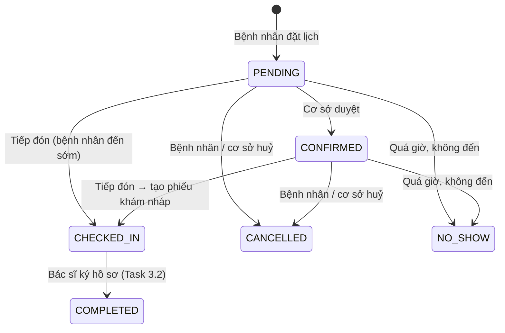

# Đặt lịch khám (Task 2.3)

## Luồng

**Bệnh nhân** (`/patient/appointments/new`): Chọn Tỉnh/Xã → Cơ sở y tế → Chuyên khoa, bác sĩ (tuỳ chọn), ngày, khung giờ → Lý do khám, triệu chứng → Xác nhận. Nhận **mã lịch hẹn** (VD `LH8K2Q7M`) để đọc tại quầy.

**Cơ sở y tế** (`/commune/appointments`, `/province/appointments`): Danh sách theo ngày, lọc trạng thái, tìm nhanh theo mã/tên/CCCD/BHYT/SĐT; Duyệt · Tiếp đón · Huỷ (kèm lý do) · Không đến. Cảnh báo dị ứng hiển thị ngay trên dòng lịch hẹn.

## Khung giờ trống

- Giờ làm việc lưu ở `facility_opening_hours` (nhiều ca mỗi ngày, theo giờ Việt Nam). Mặc định demo: T2–T6 07:30–11:30 & 13:30–16:30, T7 07:30–11:30.
- Khung giờ = chia ca theo `health_facilities.slot_duration_minutes` (mặc định 15 phút); phần lẻ cuối ca bị bỏ.
- **Sức chứa mỗi khung:**
  - Chọn bác sĩ → 1 (bác sĩ đó phải trống).
  - Không chọn → số bác sĩ của chuyên khoa tại cơ sở (tối thiểu 1).
- Khung đã qua hoặc còn dưới 30 phút thì không đặt được.

## Quy tắc & chống đặt trùng

| Quy tắc                                                         | Thực thi                                                       |
| --------------------------------------------------------------- | -------------------------------------------------------------- |
| Đặt trước ít nhất 30 phút, tối đa 30 ngày                       | API                                                            |
| Khung giờ phải đúng lưới khung của cơ sở                        | API (tính lại khung từ giờ làm việc)                           |
| Tối đa 5 lịch hẹn chưa khám / bệnh nhân                         | API                                                            |
| Không vượt sức chứa khi nhiều người đặt cùng lúc                | Khoá `pg_advisory_xact_lock` theo khung giờ trong transaction  |
| Một bác sĩ không có 2 lịch cùng giờ                             | Unique index một phần `appointments_doctor_active_slot_key`    |
| Một bệnh nhân không có 2 lịch cùng giờ (ở bất kỳ đâu)           | Unique index một phần `appointments_patient_active_slot_key`   |
| Hai nhân viên thao tác cùng lúc                                 | Cập nhật có điều kiện theo trạng thái cũ → `409` cho người sau |
| Bệnh nhân chỉ tự huỷ trước giờ hẹn; "Không đến" chỉ sau giờ hẹn | API                                                            |
| Nhân viên chỉ thao tác lịch của cơ sở mình                      | API — lịch cơ sở khác trả `404` (không lộ sự tồn tại)          |

**Tiếp đón** tạo hồ sơ khám nháp (`medical_records`, `DRAFT`) gắn với lịch hẹn: lý do khám, triệu chứng và chuyên khoa được chép sang. Bác sĩ của phiếu là bác sĩ bệnh nhân đã chọn, nếu không thì là người tiếp đón; bác sĩ thực khám được ghi lại khi ký hồ sơ (Task 3.2).

## API

| Method | Endpoint                                                       | Quyền                                         |
| ------ | -------------------------------------------------------------- | --------------------------------------------- |
| GET    | `/api/facilities?provinceCode=&communeCode=&specialtyCode=&q=` | Công khai                                     |
| GET    | `/api/facilities/:id`                                          | Công khai — chuyên khoa, bác sĩ, giờ làm việc |
| GET    | `/api/facilities/:id/slots?date=&specialtyId=&doctorId=`       | Công khai                                     |
| POST   | `/api/appointments`                                            | `PATIENT`                                     |
| GET    | `/api/appointments/me?scope=upcoming\|past`                    | `PATIENT`                                     |
| GET    | `/api/appointments/facility?date=&status=`                     | Nhân viên y tế, `ADMIN` (kèm `facilityId`)    |
| POST   | `/api/appointments/:id/confirm`                                | Nhân viên cơ sở                               |
| POST   | `/api/appointments/:id/check-in`                               | Nhân viên cơ sở                               |
| POST   | `/api/appointments/:id/no-show`                                | Nhân viên cơ sở                               |
| POST   | `/api/appointments/:id/cancel` `{ reason }`                    | Bệnh nhân chủ lịch hoặc nhân viên cơ sở       |

Trình duyệt gọi các API công khai qua proxy của web `GET /api/public/...` (chỉ cho phép danh sách đường dẫn cố định).
