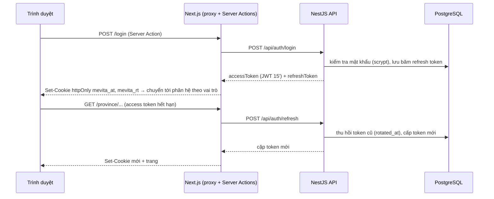

# Xác thực & Phân quyền (Task 2.1)

## Kiến trúc

- **Mô hình BFF:** trình duyệt không cầm token. Token nằm trong cookie `httpOnly; SameSite=Lax` (`Secure` khi production) trên domain của web; máy chủ Next.js gọi API kèm `Authorization: Bearer`. Cách này vẫn hoạt động khi web (Vercel) và API (Render/Railway) khác domain.
- **Access token:** JWT HS256, 15 phút (`JWT_ACCESS_TTL_SECONDS`), chứa `sub`, `role`, `fid` (cơ sở công tác), `pid` (hồ sơ bệnh nhân). Web và API dùng chung `JWT_ACCESS_SECRET`.
- **Refresh token:** chuỗi ngẫu nhiên 256 bit, chỉ lưu bản băm SHA-256 trong `refresh_tokens`, hạn 7 ngày (`REFRESH_TOKEN_TTL_DAYS`).

## Xoay vòng refresh token & phát hiện đánh cắp

Mỗi lần làm mới, token cũ bị thu hồi (`revoked_at`, `rotated_at`) và cấp token mới.

| Tình huống                                                  | Kết quả                                                                     |
| ----------------------------------------------------------- | --------------------------------------------------------------------------- |
| Token hợp lệ                                                | Cấp cặp mới                                                                 |
| Token vừa xoay vòng < 30 giây (request song song, prefetch) | Vẫn chấp nhận (`REFRESH_REUSE_GRACE_SECONDS`)                               |
| Token đã xoay vòng > 30 giây được gửi lại                   | Coi là bị đánh cắp → **thu hồi mọi phiên** của tài khoản, ghi `TOKEN_REUSE` |
| Token đã đăng xuất                                          | Từ chối, không ân hạn                                                       |

Khoảng ân hạn là cần thiết: khi access token hết hạn, trình duyệt gửi đồng thời nhiều request (điều hướng + prefetch) cùng một refresh token. Không có ân hạn, người dùng sẽ bị đăng xuất mỗi 15 phút.

## Phân quyền

**Lớp 1 — Web (`src/proxy.ts`)**: kiểm tra lạc quan trước khi render.

| Đường dẫn      | Vai trò                                    |
| -------------- | ------------------------------------------ |
| `/patient/**`  | `PATIENT`, `ADMIN`                         |
| `/commune/**`  | `COMMUNE_STAFF`, `ADMIN`                   |
| `/escort/**`   | `COMMUNE_STAFF`, `PROVINCE_STAFF`, `ADMIN` |
| `/province/**` | `PROVINCE_STAFF`, `ADMIN`                  |
| `/admin/**`    | `ADMIN` (trang chủ của quản trị viên)      |

Sai vai trò → chuyển về phân hệ của mình. Tham số `next` chỉ nhận đường dẫn nội bộ mà vai trò được phép (chống open redirect).

**Lớp 2 — API (bắt buộc)**:

- `JwtAuthGuard` (toàn cục): mọi route cần access token, trừ route `@Public()` (health, danh mục hành chính, đăng nhập/đăng ký).
- `RolesGuard` (toàn cục): `@Roles('PATIENT')`…
- `PatientAccessGuard` + `@PatientAccess('id')`: kiểm tra quyền xem hồ sơ bệnh nhân theo `AccessPolicyService`:

| Vai trò                            | Được xem bệnh nhân khi                                                                                                              |
| ---------------------------------- | ----------------------------------------------------------------------------------------------------------------------------------- |
| `ADMIN`                            | Luôn được                                                                                                                           |
| `PATIENT`                          | Là hồ sơ của chính mình                                                                                                             |
| `COMMUNE_STAFF` / `PROVINCE_STAFF` | Bệnh nhân có lịch hẹn hoặc hồ sơ khám **tại cơ sở công tác**, hoặc có phiếu chuyển tuyến **gửi đi từ / tới** cơ sở (phiếu chưa huỷ) |

Khi đã có liên hệ, nhân viên xem được toàn bộ lịch sử khám của bệnh nhân (kể cả ở cơ sở khác) để điều trị liên tục. Truy cập bị từ chối trả `403` (kể cả mã không hợp lệ, để không lộ hồ sơ có tồn tại hay không) và ghi `ACCESS_DENIED` vào `audit_logs`.

## Bảo mật khác

- Mật khẩu băm bằng **scrypt** (N=2¹⁵, r=8, p=1, salt 16 byte) — tham số theo khuyến nghị OWASP, không cần thư viện native.
- Đăng nhập sai và tài khoản không tồn tại trả **cùng thông báo, cùng thời gian xử lý** (luôn chạy so khớp mật khẩu).
- Giới hạn tần suất: đăng ký 5/phút, đăng nhập 10/phút, làm mới 30/phút mỗi IP.
- **Không tự liên kết hồ sơ theo CCCD khi đăng ký:** chỉ biết số CCCD chưa đủ chứng minh là chủ hồ sơ. Nếu CCCD đã có hồ sơ, người dùng được hướng dẫn liên hệ cơ sở y tế để liên kết sau khi đối chiếu giấy tờ.
- Tài khoản nhân viên y tế không tự đăng ký được — do quản trị viên cấp.
- Nhật ký `audit_logs`: `LOGIN`, `LOGIN_FAILED`, `LOGOUT`, `REGISTER`, `TOKEN_REUSE`, `VIEW`, `ACCESS_DENIED`.

## API

| Method | Endpoint             | Mô tả                                       |
| ------ | -------------------- | ------------------------------------------- |
| POST   | `/api/auth/register` | Bệnh nhân tự đăng ký                        |
| POST   | `/api/auth/login`    | `{ identifier, password }` — email hoặc SĐT |
| POST   | `/api/auth/refresh`  | `{ refreshToken }` → cặp token mới          |
| POST   | `/api/auth/logout`   | `{ refreshToken }` → thu hồi                |
| GET    | `/api/auth/me`       | Thông tin tài khoản đang đăng nhập          |
| GET    | `/api/patients/me`   | Hồ sơ của bệnh nhân đang đăng nhập          |
| GET    | `/api/patients/:id`  | Hồ sơ bệnh nhân (theo chính sách trên)      |

## Kiểm thử

- `apps/api/test/auth.e2e-spec.ts`: đăng ký, đăng nhập, token sai/thiếu, xoay vòng, request song song, phát hiện dùng lại, đăng xuất, toàn bộ ma trận quyền truy cập hồ sơ, audit log.
- `apps/api/src/access/access-policy.service.spec.ts`: chính sách truy cập.
