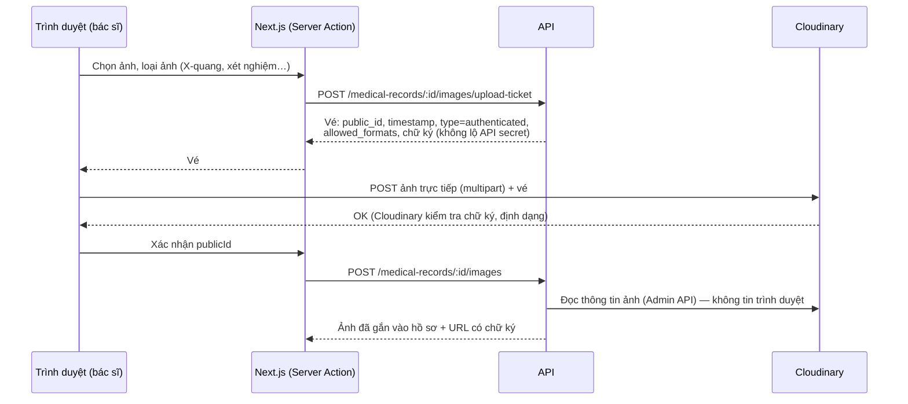

# Ảnh cận lâm sàng — Cloudinary (Task 3.3)

## Luồng tải ảnh (Signed Upload)

- Ảnh đi **thẳng từ trình duyệt lên Cloudinary**, không qua máy chủ web/API → không giới hạn bởi body size của server, nhanh hơn.
- **API secret không bao giờ rời API**; trình duyệt chỉ nhận chữ ký cho đúng một `public_id` trong thư mục `mevita/records/<mã hồ sơ>/`, hiệu lực 1 giờ, chỉ nhận JPG/PNG/WebP. Sửa bất kỳ tham số nào → chữ ký sai → Cloudinary từ chối.
- **Xác nhận phía máy chủ**: API tự đọc ảnh từ Cloudinary (dung lượng, định dạng, kích thước). Ảnh không thuộc thư mục hồ sơ, không tồn tại, quá 10 MB hoặc sai định dạng → từ chối (và xoá khỏi kho).

## Bảo mật ảnh y khoa

- Ảnh lưu dạng **`authenticated`**: URL thường không xem được; API cấp **URL có chữ ký** (ảnh gốc và ảnh thu nhỏ 240×240) mỗi lần trả hồ sơ cho người có quyền (theo chính sách truy cập bệnh nhân — docs/auth.md).
- Chỉ nhân viên **cơ sở lập phiếu** được thêm/xoá ảnh, và chỉ khi hồ sơ còn **nháp**. Sau khi ký, ảnh chỉ xem.
- Thêm/xoá ảnh ghi `audit_logs`.
- Giới hạn: 10 MB/ảnh, 20 ảnh/hồ sơ, JPG/PNG/WebP.

## Hiển thị

- Lưới **ảnh thu nhỏ** (biến đổi `c_fill,w_240,h_240,q_auto,f_auto` của Cloudinary — chỉ tải ảnh nhỏ).
- **Trình xem ảnh y khoa**: phóng to 1–4× (nút, con lăn, phím `+`/`-`), kéo để di chuyển khi phóng to, nhấp đúp đặt lại, `←` `→` chuyển ảnh, mở ảnh gốc ở tab mới. Dùng cho bác sĩ (phiếu khám, lịch sử) và bệnh nhân (Lịch sử khám bệnh).

## Chế độ giả lập (chưa có tài khoản Cloudinary)

Khi **không cấu hình** `CLOUDINARY_*` và `NODE_ENV` khác `production`, API dùng **kho ảnh giả lập** thay cho Cloudinary — luồng trên chạy y hệt:

| Cloudinary thật                                         | Giả lập                                                             |
| ------------------------------------------------------- | ------------------------------------------------------------------- |
| `https://api.cloudinary.com/v1_1/<cloud>/image/upload`  | `POST /api/mock-cloudinary/image/upload`                            |
| Kiểm tra chữ ký `api_sign_request` (SHA-1)              | **Cùng thuật toán**, khoá suy ra từ `JWT_ACCESS_SECRET`             |
| Kiểm tra định dạng, dung lượng, hạn 1 giờ, không ghi đè | Như nhau — định dạng nhận diện theo **nội dung file** (magic bytes) |
| Ảnh `authenticated` + URL ký                            | File trong `MEDIA_MOCK_DIR`, phục vụ qua URL ký HMAC                |

Production thiếu cấu hình → tắt tải ảnh (không bao giờ dùng giả lập trên môi trường thật). `GET /api/health` cho biết trạng thái Cloudinary.

### Chuyển sang Cloudinary thật

1. Tạo tài khoản tại cloudinary.com → **Settings → API Keys**.
2. Điền vào `apps/api/.env`: `CLOUDINARY_CLOUD_NAME`, `CLOUDINARY_API_KEY`, `CLOUDINARY_API_SECRET`.
3. Khởi động lại API — log không còn dòng "kho ảnh GIẢ LẬP", `/api/health` trả `"cloudinary": "connected"`.

Không cần sửa code. Ảnh đã tải lên kho giả lập không tự chuyển sang Cloudinary.

## API

| Method | Endpoint                                        | Mô tả                                                   |
| ------ | ----------------------------------------------- | ------------------------------------------------------- |
| POST   | `/api/medical-records/:id/images/upload-ticket` | `{ type }` → vé upload có chữ ký                        |
| POST   | `/api/medical-records/:id/images`               | `{ publicId, type, description? }` → xác nhận & gắn ảnh |
| DELETE | `/api/medical-records/:id/images/:imageId`      | Xoá ảnh (hồ sơ nháp)                                    |
