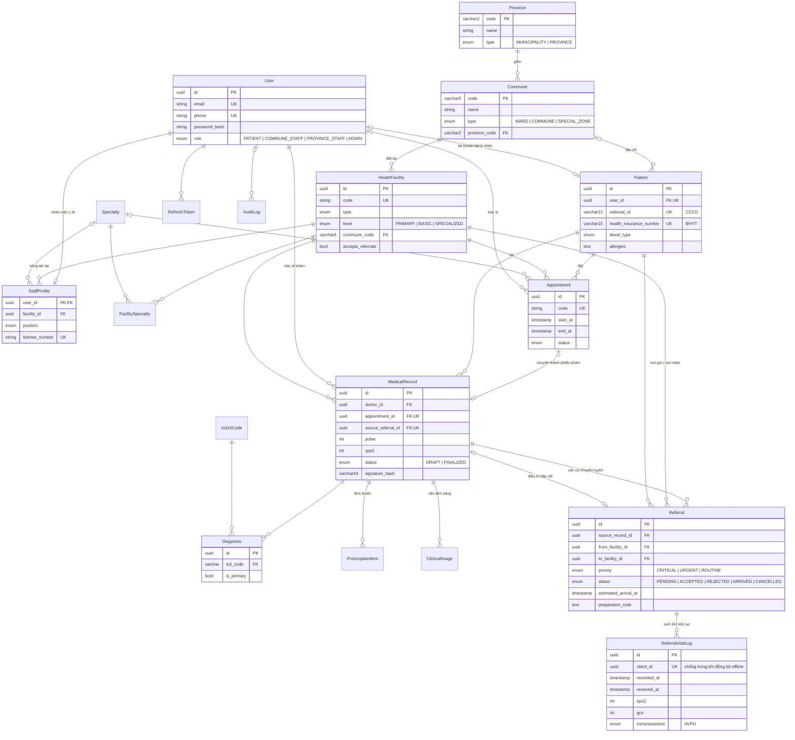

# Thiết kế Cơ sở dữ liệu (Task 1.3)

Schema nguồn: [`apps/api/prisma/schema.prisma`](../apps/api/prisma/schema.prisma) · Migration: [`apps/api/prisma/migrations`](../apps/api/prisma/migrations)

- **CSDL:** PostgreSQL 17, truy cập qua Prisma 7 (driver adapter `pg`).
- **Khoá chính:** UUID v7 (sinh theo thời gian, sắp xếp được) cho thực thể nghiệp vụ; **mã chính thức** cho danh mục (mã tỉnh, mã xã, mã ICD-10).
- **Đặt tên:** model PascalCase trong code, bảng/cột `snake_case` trong DB.

## Sơ đồ ERD

## Các bảng

| Nhóm           | Bảng                   | Vai trò                                                               |
| -------------- | ---------------------- | --------------------------------------------------------------------- |
| Danh mục       | `provinces`            | 34 tỉnh/thành ([chi tiết](administrative-units.md))                   |
|                | `communes`             | 3.321 xã/phường/đặc khu                                               |
|                | `specialties`          | 25 chuyên khoa (seed sẵn)                                             |
|                | `icd10_codes`          | Danh mục ICD-10 (nạp ở Task 3.2)                                      |
| Người dùng     | `users`                | Tài khoản đăng nhập, 1 vai trò / tài khoản                            |
|                | `staff_profiles`       | Nhân viên y tế: cơ sở công tác, chức danh, chứng chỉ hành nghề        |
|                | `refresh_tokens`       | Refresh token JWT (lưu bản băm, thu hồi được)                         |
|                | `audit_logs`           | Nhật ký truy cập dữ liệu nhạy cảm                                     |
| Cơ sở y tế     | `health_facilities`    | Trạm y tế xã, BV tỉnh, BV khu vực / Trung ương                        |
|                | `facility_specialties` | Chuyên khoa mỗi cơ sở cung cấp, có nhận đặt lịch hay không            |
| Bệnh nhân      | `patients`             | Định danh (CCCD, BHYT), nhóm máu, dị ứng — có thể không cần tài khoản |
| Khám chữa bệnh | `appointments`         | Lịch hẹn khám                                                         |
|                | `medical_records`      | Hồ sơ mỗi lần khám: bác sĩ, sinh tồn, kết luận, chữ ký                |
|                | `diagnoses`            | Chẩn đoán ICD-10: 1 bệnh chính + bệnh kèm theo                        |
|                | `prescription_items`   | Đơn thuốc                                                             |
|                | `clinical_images`      | Ảnh cận lâm sàng trên Cloudinary                                      |
| Chuyển tuyến   | `referrals`            | Phiếu chuyển tuyến & phản hồi tuyến trên                              |
|                | `referral_vital_logs`  | Chỉ số sinh tồn cập nhật liên tục trên xe                             |

## Quyết định thiết kế

**Bệnh nhân tách khỏi tài khoản.** `Patient.userId` không bắt buộc: bệnh nhân cấp cứu hoặc khám trực tiếp tại trạm y tế vẫn có hồ sơ mà không cần đăng ký. Khi bệnh nhân tự đăng ký sau đó, tài khoản được gắn vào hồ sơ sẵn có (khớp theo CCCD/BHYT).

**Phạm vi truy cập của nhân viên = cơ sở công tác.** `StaffProfile.facilityId` là căn cứ cho Guard ở Task 2.1: nhân viên chỉ xem hồ sơ có `facilityId` của cơ sở mình, hoặc thuộc `Referral` có `toFacilityId` là cơ sở mình.

**Lưu vết bác sĩ.** `MedicalRecord.doctorId` và `facilityId` được ghi tại thời điểm khám, nên lịch sử vẫn đúng khi bác sĩ chuyển công tác. Khi ký, hồ sơ chuyển `FINALIZED` kèm `signedAt` và `signatureHash` (SHA-256 nội dung) để phát hiện chỉnh sửa sau ký.

**Chuyển tuyến liên tỉnh.** Không cần cột riêng: so sánh tỉnh của `fromFacility.commune` và `toFacility.commune`.

**Điều trị tiếp nối (Task 5.1).** Hồ sơ mới tại tuyến trên trỏ về phiếu chuyển tuyến qua `MedicalRecord.sourceReferralId`, từ đó truy ngược hồ sơ tuyến xã (`Referral.sourceRecordId`), không phải hỏi lại bệnh sử.

**Offline-first trên xe cứu thương (Task 4.3).** Mỗi bản ghi sinh tồn mang `clientId` (UUID do điện thoại sinh) là khoá duy nhất: đồng bộ lại nhiều lần sau khi mất sóng không tạo bản trùng. `recordedAt` là giờ đo thực tế; `receivedAt` là giờ máy chủ nhận.

## Ràng buộc ở mức CSDL

Ngoài khoá ngoại và unique trong schema, migration `core_domain` bổ sung bằng SQL:

| Ràng buộc                              | Ý nghĩa                                                                               |
| -------------------------------------- | ------------------------------------------------------------------------------------- |
| `appointments_doctor_active_slot_key`  | Một bác sĩ không có 2 lịch hẹn còn hiệu lực cùng giờ (bỏ qua lịch đã huỷ / không đến) |
| `appointments_time_range_chk`          | `end_at > start_at`                                                                   |
| `diagnoses_one_primary_per_record_key` | Mỗi hồ sơ chỉ có 1 chẩn đoán chính                                                    |
| `medical_records_signature_chk`        | Hồ sơ `FINALIZED` phải có `signed_at` và `signature_hash`                             |
| `*_vitals_chk`                         | Sinh tồn trong ngưỡng ghi nhận được (SpO2 0–100, GCS 3–15…)                           |
| `referrals_distinct_facilities_chk`    | Nơi gửi khác nơi nhận                                                                 |
| `patients_national_id_chk`             | CCCD gồm đúng 12 chữ số                                                               |
| `users_email_or_phone_chk`             | Tài khoản có email hoặc số điện thoại                                                 |
| `health_facilities_*_chk`              | Toạ độ hợp lệ, thời lượng khung giờ 5–240 phút                                        |

Các ràng buộc trên được kiểm thử trong [`apps/api/test/schema.e2e-spec.ts`](../apps/api/test/schema.e2e-spec.ts), cùng với một kịch bản đầy đủ: Trạm Y tế Xã Mường Khương chuyển tuyến lên BVĐK Tỉnh Lào Cai.

## Chính sách xoá

- Dữ liệu y tế (`patients`, `medical_records`, `referrals`, `appointments`) dùng `RESTRICT`: không thể xoá thực thể cha khi còn hồ sơ tham chiếu.
- Dữ liệu phụ thuộc hoàn toàn (`diagnoses`, `prescription_items`, `clinical_images`, `referral_vital_logs`) xoá theo hồ sơ cha (`CASCADE`).
- Tham chiếu tuỳ chọn tới người dùng (người duyệt, người tiếp nhận) dùng `SET NULL`.
