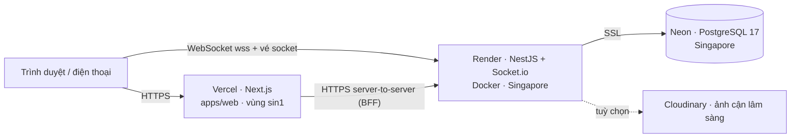

# Triển khai lên Internet (Task 6.1)



Trình duyệt chỉ giữ cookie của **web** (httpOnly, Secure, SameSite=Lax); mọi lời gọi API đi qua máy chủ Next.js (BFF). Kết nối trực tiếp duy nhất từ trình duyệt tới API là Socket.io, xác thực bằng vé ngắn hạn 60 giây. Ba dịch vụ cùng đặt ở Singapore để giảm độ trễ tới Việt Nam.

## Tệp cấu hình trong repo

| Tệp                        | Dùng cho                                                                                                        |
| -------------------------- | --------------------------------------------------------------------------------------------------------------- |
| `apps/api/Dockerfile`      | Image API: build monorepo bằng pnpm, khi khởi động chạy `prisma migrate deploy` rồi mới mở cổng; có HEALTHCHECK |
| `.dockerignore`            | Loại `node_modules`, `.env`, `.next`, ảnh giả lập… khỏi context build                                           |
| `render.yaml`              | Render Blueprint: dịch vụ web Docker, vùng Singapore, health check `/api/health`, danh sách biến môi trường     |
| `railway.json`             | Phương án thay thế: Railway build cùng Dockerfile                                                               |
| `apps/web/vercel.json`     | Vercel: framework Next.js, vùng `sin1`                                                                          |
| `.github/workflows/ci.yml` | CI mỗi lần push: format, lint, typecheck, unit, migrate + seed, e2e, build                                      |
| `.github/workflows/db.yml` | Chạy tay: migrate + seed danh mục (+ demo) trên CSDL production                                                 |

## Các bước

### 1. Neon (PostgreSQL)

1. Tạo project ở <https://console.neon.tech>, **region AWS Singapore**, PostgreSQL 17.
2. Lấy 2 chuỗi kết nối (Dashboard → Connect):
   - **Pooled** (host có `-pooler`) → `DATABASE_URL` cho API.
   - **Direct** (không `-pooler`) → `DIRECT_DATABASE_URL` cho migrate.
   - Cả hai giữ `?sslmode=require`.

### 2. Render (API)

1. Render → **New → Blueprint** → chọn repo `ShanChen6/Mevita` → Render đọc `render.yaml`.
2. Điền biến bí mật:

| Biến                  | Giá trị                                                                              |
| --------------------- | ------------------------------------------------------------------------------------ |
| `DATABASE_URL`        | Chuỗi **pooled** của Neon                                                            |
| `DIRECT_DATABASE_URL` | Chuỗi **direct** của Neon                                                            |
| `JWT_ACCESS_SECRET`   | `openssl rand -base64 48` — **giống hệt** biến cùng tên trên Vercel                  |
| `CORS_ORIGIN`         | Địa chỉ web, VD `https://mevita.vercel.app` (chưa biết thì điền tạm, sửa sau bước 3) |
| `API_PUBLIC_URL`      | `https://<tên-dịch-vụ>.onrender.com/api`                                             |
| `CLOUDINARY_*`        | Khoá Cloudinary (bỏ trống thì tính năng ảnh cận lâm sàng bị tắt ở production)        |

3. Deploy. Lần khởi động đầu tự chạy migration. Kiểm tra `https://<api>/api/health` → `"database": "up"`.

API **từ chối khởi động** nếu cấu hình production không an toàn: khoá JWT ngắn/mặc định, `CORS_ORIGIN` hoặc `API_PUBLIC_URL` không phải `https://`.

### 3. Vercel (web)

1. Vercel → **Add New → Project** → import repo → **Root Directory: `apps/web`** (Vercel tự nhận pnpm workspace).
2. Environment Variables (Production):

| Biến                     | Giá trị                          |
| ------------------------ | -------------------------------- |
| `API_URL`                | `https://<api>.onrender.com/api` |
| `NEXT_PUBLIC_API_URL`    | `https://<api>.onrender.com/api` |
| `NEXT_PUBLIC_SOCKET_URL` | `https://<api>.onrender.com`     |
| `JWT_ACCESS_SECRET`      | Trùng với Render                 |

3. Deploy, rồi cập nhật `CORS_ORIGIN` trên Render bằng địa chỉ Vercel thật (nhiều địa chỉ ngăn cách bằng dấu phẩy, VD thêm tên miền riêng). Biến `NEXT_PUBLIC_*` được nhúng lúc build → đổi thì phải deploy lại web.

### 4. Nạp dữ liệu

Cách 1 — GitHub Actions: thêm secrets `PROD_DIRECT_DATABASE_URL` và `SEED_DEMO_PASSWORD` (≥ 10 ký tự, khác mật khẩu demo mặc định) vào environment `production`, rồi **Actions → Database (production) → Run workflow** (chọn `seed`, và `demo` nếu muốn có tài khoản demo).

Cách 2 — từ máy cá nhân:

```bash
cd apps/api
DATABASE_URL="<direct>" NODE_ENV=production pnpm db:deploy
DATABASE_URL="<direct>" NODE_ENV=production pnpm db:seed
DATABASE_URL="<direct>" NODE_ENV=production SEED_DEMO=true SEED_DEMO_PASSWORD="<mật khẩu demo>" pnpm db:seed
```

Ở production, dữ liệu demo **chỉ** được tạo khi đặt `SEED_DEMO=true` kèm `SEED_DEMO_PASSWORD` riêng. Không chạy `sim:stats` (bị chặn khi `NODE_ENV=production`).

### 5. Kiểm tra sau triển khai

- `GET /api/health` → `status: ok`, `database: up`, `cloudinary: connected` (nếu đã cấu hình).
- Đăng nhập web bằng tài khoản demo; header hiện **Đang trực** (kênh realtime thông).
- Hai thiết bị: bác sĩ xã gửi lệnh chuyển tuyến → bác sĩ tỉnh nhận popup + âm thanh; điện thoại "Trên xe" gửi sinh tồn → biểu đồ cập nhật.

## Lưu ý vận hành

- **Render gói free** ngủ sau 15 phút không có request; lần gọi đầu mất ~1 phút để khởi động và kết nối realtime rơi khi ngủ (client tự kết nối lại). Ngày bảo vệ: nâng lên gói Starter hoặc mở web trước 5 phút. Gói free cũng không có ổ đĩa lâu dài — vì vậy production dùng Cloudinary thật, không dùng kho ảnh giả lập.
- **Neon gói free** tự tạm dừng compute khi rảnh (đánh thức ~1 giây) và giới hạn số kết nối → `DATABASE_POOL_MAX=5` trong `render.yaml`.
- Một instance API phục vụ được ~1.000+ kết nối realtime (xem [testing.md](testing.md)); nhiều instance cần Redis adapter + sticky session.
- Header bảo mật: API gửi `X-Content-Type-Options`, `X-Frame-Options: DENY`, `Referrer-Policy`, `HSTS` (production); web gửi `X-Frame-Options`, `Referrer-Policy`, `Permissions-Policy` (chỉ cho phép camera — chụp ảnh — và định vị — chia sẻ vị trí xe).
- Docker Hub giới hạn số lần tải ảnh gốc: build tại máy có thể dùng `--build-arg NODE_IMAGE=mirror.gcr.io/library/node:22-slim`.

## Đã kiểm chứng trước khi deploy (máy phát triển)

- Build image từ `apps/api/Dockerfile`; chạy trên CSDL **trống** với `NODE_ENV=production`: tự áp dụng 6 migration, khởi động, `/api/health` OK, header bảo mật đúng; `prisma db seed` trong container nạp 34 tỉnh / 3.321 xã / 269 mã ICD-10; demo chỉ tạo khi có `SEED_DEMO=true` + mật khẩu riêng.
- Cấu hình không an toàn (khoá JWT mặc định, origin `http://`) → API dừng với thông báo rõ ràng.
- Web build production trỏ vào API trong container: đăng nhập, cookie `httpOnly + Secure + SameSite=Lax`, BFF gọi API; kênh realtime từ origin không thuộc `CORS_ORIGIN` bị từ chối (403).
