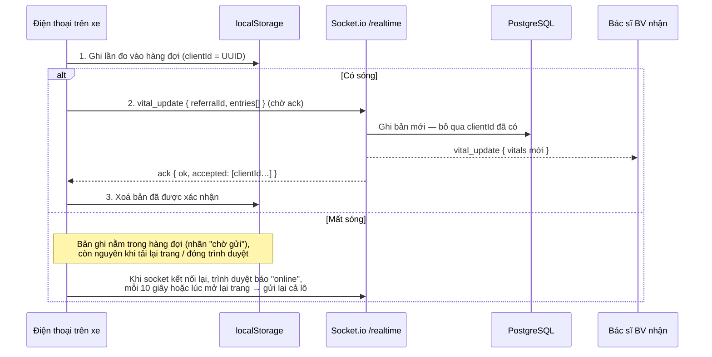

# Cập nhật sinh tồn trên xe chuyển viện (Task 4.3)

Nhân viên y tế đi kèm xe mở **`/escort/<id phiếu chuyển tuyến>`** trên điện thoại (nút **"Trên xe"** ở danh sách chuyển tuyến, hoặc **"Màn hình trên xe"** ở chi tiết phiếu). Mỗi lần đo được đẩy ngay lên màn hình bác sĩ bệnh viện nhận qua Socket.io; khi xe đi qua vùng mất sóng, dữ liệu được lưu tạm trên máy và tự gửi khi có mạng.

## Màn hình trên xe

- Tối giản cho điện thoại, không sidebar: tên, tuổi, mã phiếu, **đếm ngược thời gian tới**, mức độ ưu tiên, bệnh viện nhận và **số đường dây nóng** (bấm để gọi), dị ứng/nhóm máu, ghi chú chuẩn bị của tuyến trên (Task 4.4).
- Ô nhập lớn (chữ 24 px, bàn phím số): Mạch, Huyết áp (`120/80`), SpO2, Nhịp thở, Glasgow; tri giác **AVPU** bằng 4 nút lớn; ghi chú. Chỉ cần nhập chỉ số đo được — tối thiểu một chỉ số.
- Thanh trạng thái: _Đã kết nối_ (xanh) / _Mất sóng — N lần đo lưu tạm_ (vàng). Nhật ký trên xe hiện ngay cả bản chưa gửi (nhãn **chờ gửi**). Bản bị máy chủ từ chối hẳn (VD ca đã huỷ) hiện riêng để người dùng bỏ đi.
- Người dùng: nhân viên cơ sở gửi (`COMMUNE_STAFF`, và `PROVINCE_STAFF` khi bệnh viện tỉnh chuyển lên trung ương). Phiếu đã kết thúc thì không hiện form.

## Màn hình bệnh viện nhận

- Chi tiết ca (`/province/referrals/[id]`) có khung **Diễn biến sinh tồn trên xe**: 4 ô chỉ số gần nhất (giá trị gần nhất đã đo của từng chỉ số), **biểu đồ Recharts** (Mạch, HA tâm thu, SpO2), bảng nhật ký. Cập nhật trực tiếp khi nhận `vital_update`, không tải lại trang. Chỉ số vượt ngưỡng tô đỏ: mạch < 50 hoặc > 120, HA tâm thu < 90 hoặc > 180, SpO2 < 94 %, nhịp thở < 10 hoặc > 28, Glasgow ≤ 8.
- Bảng điều phối (`/province`): thẻ ca hiện lần đo mới nhất trên xe kèm giờ đo, tự làm mới khi có chỉ số mới.
- Cơ sở gửi cũng nhận `vital_update` (xem được diễn biến ở `/commune/referrals/[id]`).

## Chống mất dữ liệu & ghi trùng

| Tình huống                                      | Cách xử lý                                                                                                                           |
| ----------------------------------------------- | ------------------------------------------------------------------------------------------------------------------------------------ |
| Mất sóng khi gửi                                | Bản ghi đã nằm trong `localStorage` (`mevita:vitals-queue:<referralId>`) trước khi gửi; chỉ xoá khi ack của máy chủ chứa `clientId`. |
| Gửi xong nhưng ack bị mất (mạng rớt giữa chừng) | Thiết bị gửi lại; máy chủ nhận ra `clientId` đã có (cột `client_id` UNIQUE) → không ghi trùng, vẫn trả `accepted` để xoá hàng đợi.   |
| Tải lại trang / đóng trình duyệt / hết pin      | Hàng đợi còn trong `localStorage`, tự gửi khi mở lại màn hình trên xe.                                                               |
| Đồng bộ muộn                                    | `recordedAt` = giờ đo trên xe, `receivedAt` = giờ máy chủ nhận → biểu đồ đúng trình tự thời gian thực tế.                            |
| Đồng hồ thiết bị sai                            | Từ chối giờ đo lệch quá 5 phút về tương lai hoặc trước lúc tạo phiếu.                                                                |
| Xe đã tới nơi khi bản ghi còn trong hàng đợi    | Phiếu `ARRIVED` vẫn nhận dữ liệu đồng bộ muộn trong 6 giờ; phiếu huỷ/từ chối thì không (`retry: false`).                             |

Giới hạn hiện tại: trang phải được mở (tải xong) trước khi xe vào vùng mất sóng — chưa có Service Worker để mở trang khi hoàn toàn không có mạng (có thể bổ sung PWA ở Giai đoạn 6).

## API

| Kênh                     | Đường dẫn / sự kiện          | Mô tả                                                                                                                                                  |
| ------------------------ | ---------------------------- | ------------------------------------------------------------------------------------------------------------------------------------------------------ |
| Socket (client → server) | `vital_update` + ack         | `{ referralId, entries: VitalEntry[1..100] }` → `{ ok: true, accepted, created }` hoặc `{ ok: false, message, retry }`. `retry: false` = đừng gửi lại. |
| Socket (server → client) | `vital_update`               | Tới `facility_<BV nhận>` và `facility_<cơ sở gửi>`: `{ referralId, code, vitals: VitalLog[] }` — chỉ gồm bản mới ghi.                                  |
| REST                     | `GET /referrals/:id/vitals`  | Nhật ký cũ → mới; nhân viên cơ sở gửi/nhận.                                                                                                            |
| REST                     | `POST /referrals/:id/vitals` | `{ entries }` — dự phòng khi không dùng được socket, cùng quy tắc idempotent.                                                                          |

`VitalEntry`: `clientId` (UUID), `recordedAt` (ISO), `pulse` 20–250, `systolicBp` 40–300 / `diastolicBp` 20–200 (nhập đủ cả hai, tâm thu > tâm trương), `spo2` 50–100, `respiratoryRate` 4–80, `temperature` 30–45, `consciousness` `ALERT|VOICE|PAIN|UNRESPONSIVE`, `gcs` 3–15, `note` ≤ 500 — ít nhất một chỉ số. Chi tiết phiếu (`GET /referrals/:id`) có thêm `latestVital`.

Quyền ghi: nhân viên thuộc cơ sở gửi hoặc người được chỉ định đi kèm; bệnh viện nhận chỉ xem.

## Kiểm thử

- `apps/api/test/referrals.e2e-spec.ts` (mục _sinh tồn trên xe_): gửi qua socket → bệnh viện nhận dưới 1 giây; gửi lại lô cũ + bản mới chỉ ghi bản mới; REST idempotent; bệnh viện nhận/cơ sở khác không ghi được; dữ liệu sai, giờ đo tương lai, HA ngược; phiếu đã huỷ không nhận thêm.
- Kiểm thử trình duyệt (Playwright, iPhone 13 + máy bàn, dữ liệu demo): chỉ số tới màn hình bệnh viện ~60 ms; giả lập mất mạng → 2 lần đo nằm trong `localStorage`, bệnh viện chưa nhận; đóng trang, có mạng, mở lại → tự đồng bộ, hàng đợi được xoá, CSDL không trùng, giữ đúng giờ đo; mất sóng giữa chừng khi vẫn mở trang → tự gửi khi có mạng; thẻ ca trên bảng điều phối tự cập nhật; không tràn ngang trên điện thoại.
