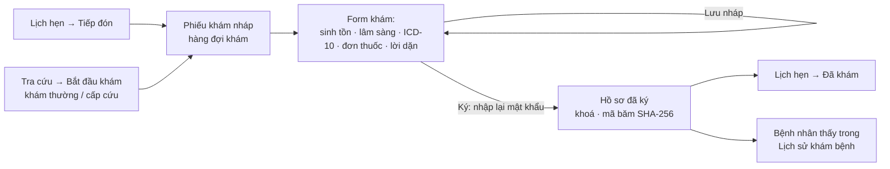

# Khám lâm sàng, chẩn đoán ICD-10 & ký hồ sơ (Task 3.2)

## Luồng



Màn hình: `/{commune|province}/encounters` (hàng đợi — **cấp cứu lên đầu**) → `/{commune|province}/encounters/:id`.

## Form khám

- **Sinh tồn**: mạch, nhiệt độ, huyết áp, nhịp thở, SpO2, cân nặng, chiều cao. Ô **tô vàng** khi ngoài ngưỡng bình thường người lớn, **tô đỏ** khi cần xử trí ngay. Chấp nhận dấu phẩy thập phân (`38,5`).
- **Cảnh báo dị ứng & bệnh mạn tính** luôn hiển thị phía trên form (ghim khi cuộn) và nhắc lại ở phần đơn thuốc.
- **Chẩn đoán ICD-10**: gõ mã (`I10`, `S06`) hoặc tên có/không dấu (`tăng huyết áp`, `viem phoi`, `gay xuong dui`); chọn bằng chuột hoặc ↑ ↓ Enter. Mã đầu tiên là **bệnh chính**, bấm ★ để đổi. Tối đa 10 mã.
- **Đơn thuốc**: tên thuốc, hàm lượng, số lượng, đơn vị, số ngày, cách dùng — thêm/xoá dòng.
- **Lời dặn & ngày tái khám**.
- **Lưu nháp** bất kỳ lúc nào; cảnh báo khi rời trang còn thay đổi chưa lưu.

## Ký xác nhận

- Chỉ **bác sĩ hoặc y sĩ** (`DOCTOR`, `PHYSICIAN_ASSISTANT`) được ký; điều dưỡng, tiếp đón chỉ nhập liệu.
- Người ký **nhập lại mật khẩu** (tương đương chữ ký); sai mật khẩu → không ký, ghi audit.
- Điều kiện: có lý do khám và **đúng một bệnh chính**.
- Khi ký, hệ thống **tự ghi bác sĩ đang đăng nhập** vào `doctorId` (kể cả khi phiếu do điều dưỡng mở), đặt `signedAt`, tính **mã băm SHA-256** của nội dung chuyên môn và **khoá hồ sơ** (`FINALIZED` — không sửa được nữa, ràng buộc ở cả API và DB).
- **Kiểm tra toàn vẹn** (`GET /medical-records/:id/verify`): tính lại mã băm và so với lúc ký — trang hồ sơ đã ký hiển thị "Hồ sơ toàn vẹn" hoặc cảnh báo nếu nội dung bị sửa trực tiếp trong CSDL.

Nội dung được băm: bệnh nhân, bác sĩ ký, cơ sở, thời điểm khám, lý do khám, triệu chứng, khám thực thể, sinh tồn, kết luận, hướng điều trị, các mã ICD-10 (kèm bệnh chính) và đơn thuốc.

## Danh mục ICD-10

> **Lưu ý:** Môi trường phát triển không truy cập được bảng ICD-10 chính thức của Bộ Y tế. Dự án kèm **danh mục rút gọn 269 mã thường gặp** (`apps/api/prisma/data/icd10-curated.csv`) — bệnh nhiễm trùng, hô hấp, tim mạch, tiêu hoá, cơ xương khớp, sản khoa, chấn thương (sọ não, gãy xương), ngộ độc, cấp cứu — với tên tiếng Việt theo cách gọi phổ biến. **Cần nhập bảng chính thức trước khi dùng thật.**

Nhập bảng chính thức (QĐ 4469/QĐ-BYT, xuất từ Excel ra CSV UTF-8):

```bash
pnpm --filter @mevita/api icd10:import duong/dan/icd10.csv
```

- Cột bắt buộc: mã (`code` / `Mã bệnh`) và tên tiếng Việt (`name_vi` / `Tên bệnh`); tuỳ chọn tên tiếng Anh, chương.
- Tự nhận diện dấu phân tách `,` `;` tab; bỏ BOM; chuẩn hoá mã thiếu dấu chấm (`S065` → `S06.5`); bỏ qua dòng tiêu đề nhóm (`A00-A09`).
- Chạy lại an toàn: thêm mới / cập nhật, không xoá mã đang dùng. Sau khi nhập bảng đầy đủ, `db:seed` không ghi đè bằng danh mục rút gọn.

## API

| Method | Endpoint                          | Quyền                                                                                   |
| ------ | --------------------------------- | --------------------------------------------------------------------------------------- |
| GET    | `/api/icd10?q=&limit=`            | Đã đăng nhập                                                                            |
| GET    | `/api/medical-records/open`       | Nhân viên y tế — hàng đợi khám của cơ sở                                                |
| GET    | `/api/medical-records/:id`        | Nhân viên cơ sở lập phiếu; hồ sơ đã ký theo chính sách truy cập                         |
| PATCH  | `/api/medical-records/:id`        | Nhân viên cơ sở, chỉ khi nháp — danh sách chẩn đoán/thuốc gửi lên thay thế danh sách cũ |
| POST   | `/api/medical-records/:id/sign`   | Bác sĩ/y sĩ của cơ sở — `{ password }`                                                  |
| GET    | `/api/medical-records/:id/verify` | Như xem hồ sơ                                                                           |
