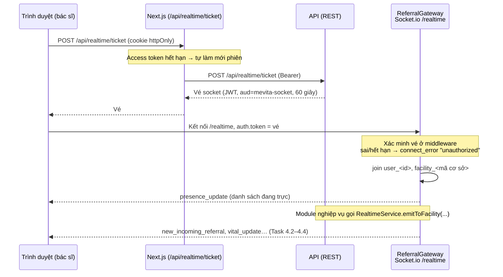

# Kiến trúc Real-time — Socket.io (Task 4.1)

## Tổng quan

## Phòng (rooms)

| Phòng                 | Ai vào                                  | Dùng cho                                                             |
| --------------------- | --------------------------------------- | -------------------------------------------------------------------- |
| `facility_<mã cơ sở>` | Nhân viên y tế đang đăng nhập của cơ sở | Cảnh báo ca chuyển tuyến tới bệnh viện (4.2), sinh tồn trên xe (4.3) |
| `user_<id>`           | Mọi kết nối của một người               | Thông báo riêng (VD: tuyến trên xác nhận cho bác sĩ gửi)             |
| `admins`              | Quản trị                                | Giám sát                                                             |

Khi bác sĩ tuyến tỉnh mở bất kỳ màn hình nào của phân hệ, trình duyệt tự kết nối và **tự vào phòng của bệnh viện mình** — không cần thao tác "nhận trực".

## Xác thực

- Web giữ token trong cookie `httpOnly` (JavaScript không đọc được). Trình duyệt xin **vé socket** qua máy chủ web; vé là JWT riêng (`aud = mevita-socket`), sống **60 giây**, chỉ dùng để mở kết nối. Access token thường không mở được socket.
- Mỗi lần kết nối lại (mất mạng, API khởi động lại) trình duyệt xin vé mới; nếu access token đã hết hạn, route vé tự làm mới phiên bằng refresh token.
- Xác thực một lần khi mở kết nối (middleware `server.use`). Guard HTTP (`JwtAuthGuard`, `RolesGuard`) bỏ qua ngữ cảnh WebSocket.
- Gói tin tối đa 64 KB; CORS dùng chung `CORS_ORIGIN` với HTTP.

## Người đang trực (presence)

- Đếm theo người, nhiều tab của một người tính là một; rời trực khi đóng tab cuối.
- Có thay đổi → phát `presence_update` tới phòng cơ sở. Giao diện hiển thị đèn **"Đang trực · N"** trên thanh tiêu đề (rê chuột để xem tên), hoặc **"Mất kết nối — đang thử lại"**.
- `GET /api/realtime/presence` — danh sách đang trực của cơ sở mình.
- Lưu trong bộ nhớ của một tiến trình API. Chạy nhiều instance cần **Socket.io Redis adapter** và lưu presence dùng chung (kiểm thử tải ở Task 5.3).

## Sự kiện

| Sự kiện (server → client) | Payload                        | Task |
| ------------------------- | ------------------------------ | ---- |
| `presence_update`         | `{ facilityId, onDuty[] }`     | 4.1  |
| `channel_test`            | `{ facilityId, from, sentAt }` | 4.1  |
| `new_incoming_referral`   | Phiếu chuyển tuyến mới         | 4.2  |
| `vital_update`            | Chỉ số sinh tồn trên xe        | 4.3  |

Client → server: `whoami` (ack: người dùng & phòng đang ở — kiểm tra kết nối).

**Kiểm tra kênh trực**: nút trên Trung tâm điều phối gửi `POST /api/realtime/test-signal` → mọi đồng nghiệp đang trực cùng cơ sở nhận thông báo; người gửi thấy số kết nối đã nhận.
