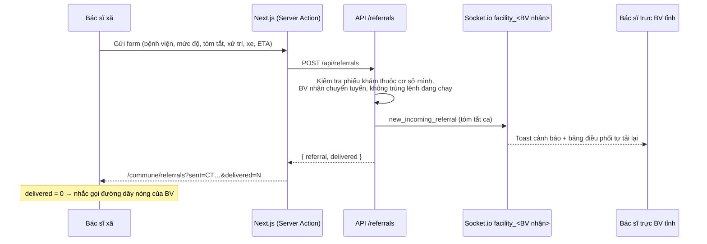

# Lệnh chuyển tuyến khẩn cấp (Task 4.2)

Bác sĩ tuyến dưới (trạm y tế xã, hoặc bệnh viện tỉnh chuyển lên tuyến trung ương) tạo **lệnh chuyển tuyến** từ phiếu khám của bệnh nhân. Bác sĩ đang trực tại bệnh viện nhận được cảnh báo qua Socket.io ngay khi lệnh được gửi (đo trên máy phát triển: ~80–120 ms tính từ lúc bấm gửi).



## Giao diện

| Màn hình                                            | Nội dung                                                                                                                                                                                                                                                                                                                                                                       |
| --------------------------------------------------- | ------------------------------------------------------------------------------------------------------------------------------------------------------------------------------------------------------------------------------------------------------------------------------------------------------------------------------------------------------------------------------ |
| Phiếu khám → **Chuyển tuyến khẩn cấp**              | Nút đỏ ở đầu phiếu khám (cả tuyến xã và tỉnh), mở `/…/referrals/new?record=<id>`.                                                                                                                                                                                                                                                                                              |
| `/commune/referrals/new`, `/province/referrals/new` | Chọn bệnh viện (nhóm **Trong tỉnh** / **Liên tỉnh**, số bác sĩ đang trực trực tuyến, đường dây nóng, chuyên khoa), mức độ ưu tiên, lý do, **tóm tắt bệnh án soạn sẵn** từ phiếu khám (tuổi, giới, lý do vào, bệnh sử, sinh tồn, chẩn đoán ICD-10, dị ứng, tiền sử), xử trí sơ cứu (gợi ý từ đơn thuốc), người đi kèm, phương tiện, thời gian dự kiến tới (nút nhanh 15′–120′). |
| `/commune/referrals`                                | Danh sách lệnh đã gửi, thông báo kết quả gửi, huỷ lệnh (kèm lý do).                                                                                                                                                                                                                                                                                                            |
| `/province`                                         | Bảng điều phối: ca đang tới (chờ tiếp nhận / đã nhận), sắp theo mức độ rồi thời gian xe tới, đếm ngược, dị ứng, sinh tồn lúc khám. Tự cập nhật khi có ca mới hoặc ca bị huỷ.                                                                                                                                                                                                   |
| `/province/referrals`, `/[id]`                      | Danh sách ca tới và ca bệnh viện chuyển đi; chi tiết ca: thông tin chuyên môn, sinh tồn, thuốc đã dùng, liên lạc (cơ sở gửi, bác sĩ chuyển, người đi kèm, người nhà).                                                                                                                                                                                                          |

Toast cảnh báo ca mới hiện ở mọi trang của bác sĩ tuyến tỉnh; ca **Cấp cứu tối khẩn** không tự tắt. Âm thanh, popup toàn màn hình và nút tiếp nhận / sẵn sàng ê-kíp thuộc Task 4.4; màn hình trên xe và biểu đồ sinh tồn trực tiếp thuộc Task 4.3.

## API

Chỉ `COMMUNE_STAFF` và `PROVINCE_STAFF`.

| Phương thức | Đường dẫn                 | Mô tả                                                                                                                                |
| ----------- | ------------------------- | ------------------------------------------------------------------------------------------------------------------------------------ |
| GET         | `/referrals/destinations` | Bệnh viện nhận chuyển tuyến (trừ cơ sở mình), cùng tỉnh trước, kèm `onDutyCount`, `emergencyPhone`, chuyên khoa. `?q=` lọc theo tên. |
| GET         | `/referrals/escorts`      | Nhân viên cơ sở mình có thể đi kèm xe.                                                                                               |
| POST        | `/referrals`              | Tạo lệnh. Trả `{ referral, delivered }` — `delivered` là số kết nối trực đã nhận cảnh báo.                                           |
| GET         | `/referrals`              | `?direction=incoming\|outgoing` (bắt buộc), `&status=`, `&active=true` (chỉ PENDING/ACCEPTED, sắp theo ưu tiên → ETA).               |
| GET         | `/referrals/:id`          | Chi tiết — chỉ nhân viên cơ sở gửi/nhận (hoặc ADMIN); ghi nhật ký truy cập.                                                          |
| POST        | `/referrals/:id/cancel`   | `{ reason }` — chỉ cơ sở gửi, khi lệnh còn PENDING/ACCEPTED. Phát `referral_updated` tới bệnh viện nhận.                             |

Body `POST /referrals`:

```json
{
  "sourceRecordId": "uuid phiếu khám của cơ sở mình",
  "toFacilityId": "uuid bệnh viện nhận",
  "priority": "CRITICAL | URGENT | ROUTINE",
  "reason": "5–1000 ký tự",
  "clinicalSummary": "10–5000 ký tự",
  "initialTreatment": "tuỳ chọn",
  "escortId": "uuid nhân viên cùng cơ sở, tuỳ chọn",
  "vehicleInfo": "tuỳ chọn",
  "etaMinutes": 45
}
```

Quy tắc: phiếu khám phải thuộc cơ sở người gửi; bệnh viện nhận phải bật `acceptsReferrals` và khác cơ sở mình; người đi kèm phải cùng cơ sở; một phiếu khám chỉ có **một** lệnh đang thực hiện (409 nếu gửi trùng). Mã lệnh dạng `CT` + 6 ký tự; `estimatedArrivalAt = now + etaMinutes`.

### Sự kiện Socket.io

| Sự kiện                 | Phòng                | Nội dung                                                                                                                                                                                     |
| ----------------------- | -------------------- | -------------------------------------------------------------------------------------------------------------------------------------------------------------------------------------------- |
| `new_incoming_referral` | `facility_<BV nhận>` | `id, code, priority, createdAt, estimatedArrivalAt, reason, patient{fullName, dateOfBirth, gender, allergies, bloodType}, diagnosis{icdCode,name}, fromFacility{name, province}, referredBy` |
| `referral_updated`      | `facility_<BV nhận>` | `id, code, status, cancellationReason` (hiện dùng cho huỷ lệnh; tiếp nhận/từ chối ở Task 4.4)                                                                                                |

## Khi không ai trực trực tuyến

Lệnh vẫn được lưu và hiện trên bảng điều phối khi bác sĩ bệnh viện mở hệ thống. Form cảnh báo trước khi gửi, và sau khi gửi (`delivered = 0`) màn hình nhắc **gọi đường dây nóng** (`emergencyPhone` của cơ sở, dữ liệu mẫu: BVĐK Lào Cai `0900 111 115`, Việt Đức `0900 222 115`).

## Kiểm thử

- `apps/api/test/referrals.e2e-spec.ts`: thứ tự bệnh viện đích & số người trực, tạo lệnh → cảnh báo tới đúng phòng dưới 1 giây, `delivered`, chặn lệnh trùng (409), quyền xem chi tiết, danh sách tới/đi, huỷ → `referral_updated`, ca liên tỉnh không ai trực (`delivered = 0`), dữ liệu sai (400/404).
- Kiểm thử trình duyệt (Playwright, dữ liệu demo): bác sĩ xã gửi lệnh từ phiếu khám → 2 bác sĩ BVĐK nhận toast và thẻ ca mới không cần tải lại; chi tiết ca; chặn gửi trùng; gửi liên tỉnh tới Việt Đức → cảnh báo đường dây nóng; huỷ lệnh → bệnh viện nhận thông báo và thẻ ca biến mất; form không tràn ngang ở màn hình 390 px.
