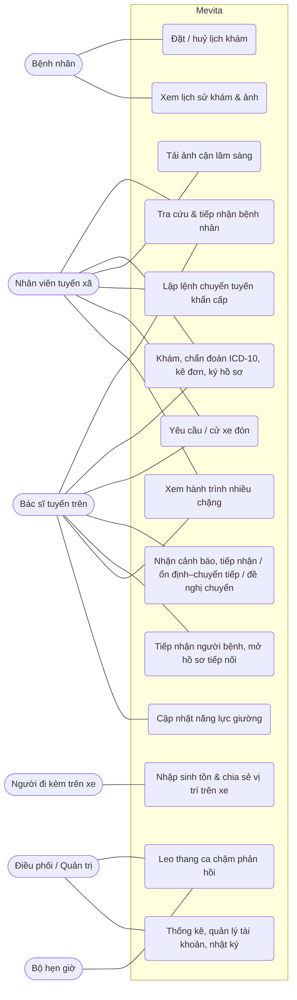

# Chương 1. Đặc tả yêu cầu phần mềm

## 1.1. Bối cảnh và bài toán

Từ 01/07/2025 Việt Nam vận hành chính quyền địa phương 2 cấp, gồm 34 tỉnh/thành và 3.321 xã/phường/đặc khu.
Tuyến y tế cơ sở là các trạm y tế xã. Đây là nơi người dân, nhất là ở vùng núi, tiếp cận đầu tiên. Khi một ca
vượt khả năng chuyên môn, trạm phải chuyển người bệnh lên bệnh viện tỉnh, có khi tiếp tục lên tuyến trung ương.

Quy trình chuyển tuyến hiện nay chủ yếu dựa vào giấy chuyển viện và điện thoại. Cách làm này gây ra năm vấn đề:

1. **Tuyến trên không biết trước ca bệnh.** Thông tin chỉ đến khi xe tới cổng, nên ê-kíp không chuẩn bị kịp.
2. **Không biết diễn biến trên xe.** Chặng đường ở vùng núi kéo dài 1–5 giờ, nhưng các chỉ số sinh tồn đo trên xe không được truyền về bệnh viện.
3. **Bệnh viện quá tải.** Bệnh viện thường xuyên đông bệnh nhân, và vẫn có trường hợp người bệnh bị từ chối hoặc phải chờ.
   Luật Khám bệnh, chữa bệnh số 15/2023/QH15 nghiêm cấm việc từ chối hoặc cố ý chậm cấp cứu người bệnh.
4. **Hồ sơ đứt đoạn giữa các tuyến.** Bác sĩ tuyến trên phải hỏi lại từ đầu. Với ca đi nhiều chặng (xã → tỉnh → trung ương), thông tin càng thất lạc.
5. **Thiếu phương tiện.** Trạm y tế xã thường không có xe cứu thương đạt chuẩn.

**Mevita** là hệ thống hồ sơ y tế điện tử (EMR) liên thông 3 tuyến. Hệ thống có đặt lịch khám và **chuyển tuyến
cấp cứu thời gian thực**. Ngay khi tuyến dưới bấm gửi, bệnh viện nhận được cảnh báo. Diễn biến sinh tồn và vị trí
xe được cập nhật liên tục kể cả khi mất sóng. Hệ thống điều phối thay cho việc từ chối, và hồ sơ đi theo người bệnh
qua mọi chặng.

## 1.2. Mục tiêu

| Mã  | Mục tiêu                                                             | Chỉ số đo                                                                                        |
| --- | -------------------------------------------------------------------- | ------------------------------------------------------------------------------------------------ |
| MT1 | Cảnh báo ca chuyển tuyến tới bác sĩ trực tuyến trên gần như tức thời | Độ trễ cảnh báo p99 < 1 giây (đo được 0,72 giây với 1.000 lệnh đồng thời)                        |
| MT2 | Bệnh viện nhận theo dõi được người bệnh trên xe                      | Sinh tồn và vị trí xe hiển thị trong vài giây; không mất dữ liệu khi mất sóng                    |
| MT3 | Không ca cấp cứu nào bị từ chối vì quá tải                           | API chặn thao tác từ chối ca tối khẩn/khẩn; tự leo thang khi bệnh viện chậm phản hồi             |
| MT4 | Hồ sơ liên tục qua các tuyến                                         | Hồ sơ tiếp nối kế thừa dữ liệu tuyến dưới; mọi chặng thấy toàn bộ hành trình                     |
| MT5 | Bảo vệ dữ liệu sức khoẻ                                              | Phân quyền theo cơ sở và quan hệ khám chữa bệnh; nhật ký truy cập; hồ sơ ký có kiểm tra toàn vẹn |

## 1.3. Tác nhân

| Tác nhân                     | Vai trò hệ thống | Mô tả                                                                                                                 |
| ---------------------------- | ---------------- | --------------------------------------------------------------------------------------------------------------------- |
| Bệnh nhân                    | `PATIENT`        | Tự đăng ký, đặt lịch khám, xem lịch sử khám đã ký và ảnh cận lâm sàng của mình                                        |
| Nhân viên tuyến xã           | `COMMUNE_STAFF`  | Bác sĩ/y sĩ khám và ký hồ sơ, lập lệnh chuyển tuyến. Điều dưỡng tiếp đón, đi kèm xe, nhập sinh tồn                    |
| Bác sĩ tuyến trên            | `PROVINCE_STAFF` | Thuộc bệnh viện tỉnh hoặc trung ương. Trực cấp cứu, phản hồi ca chuyển tới, cử xe đón, mở hồ sơ tiếp nối, chuyển tiếp |
| Quản trị / điều phối Sở Y tế | `ADMIN`          | Xem thống kê, quản lý tài khoản, nhật ký, theo dõi ca leo thang và năng lực bệnh viện                                 |
| Bộ hẹn giờ hệ thống          | —                | Quét ca chậm phản hồi mỗi 30 giây để leo thang                                                                        |

## 1.4. Yêu cầu chức năng

Cột "Tài liệu" dẫn tới thiết kế chi tiết. Mọi yêu cầu đều có kiểm thử e2e API và đã được kiểm tra trên trình duyệt.

### Tài khoản & phân quyền

| Mã    | Yêu cầu                                                                                                                                                              | Tài liệu                            |
| ----- | -------------------------------------------------------------------------------------------------------------------------------------------------------------------- | ----------------------------------- |
| FR-01 | Bệnh nhân tự đăng ký. Đăng nhập bằng email hoặc số điện thoại                                                                                                        | [auth.md](../auth.md)               |
| FR-02 | Phiên đăng nhập dùng access token 15 phút và refresh token xoay vòng 7 ngày. Phát hiện refresh token bị dùng lại thì thu hồi mọi phiên                               | [auth.md](../auth.md)               |
| FR-03 | Phân quyền theo 4 vai trò và theo cơ sở công tác. Nhân viên chỉ xem được bệnh nhân đã có quan hệ khám chữa bệnh với cơ sở mình (lịch hẹn, hồ sơ, phiếu chuyển tuyến) | [auth.md](../auth.md)               |
| FR-04 | Quản trị viên khoá/mở tài khoản. Khoá thì mất phiên ngay và ngắt kết nối realtime                                                                                    | [stats-admin.md](../stats-admin.md) |

### Cổng bệnh nhân & đặt lịch

| Mã    | Yêu cầu                                                                                                                 | Tài liệu                                  |
| ----- | ----------------------------------------------------------------------------------------------------------------------- | ----------------------------------------- |
| FR-05 | Bệnh nhân xem và cập nhật hồ sơ cá nhân: CCCD, BHYT, dị ứng, liên hệ khẩn cấp                                           | [patient-portal.md](../patient-portal.md) |
| FR-06 | Bệnh nhân xem lịch sử khám đã ký, gồm chẩn đoán, đơn thuốc và ảnh cận lâm sàng                                          | [patient-portal.md](../patient-portal.md) |
| FR-07 | Đặt lịch theo khung giờ trống, tính từ giờ làm việc và sức chứa của cơ sở. Chống đặt trùng khi nhiều người đặt cùng lúc | [appointments.md](../appointments.md)     |
| FR-08 | Cơ sở duyệt, huỷ, tiếp đón lịch hẹn. Tiếp đón thì tạo phiếu khám                                                        | [appointments.md](../appointments.md)     |

### Khám bệnh & hồ sơ

| Mã    | Yêu cầu                                                                                                                     | Tài liệu                                    |
| ----- | --------------------------------------------------------------------------------------------------------------------------- | ------------------------------------------- |
| FR-09 | Tra cứu bệnh nhân bằng CCCD, BHYT hoặc SĐT (khớp chính xác) trên toàn hệ thống. Hiện cảnh báo dị ứng và 5 lần khám gần nhất | [patient-lookup.md](../patient-lookup.md)   |
| FR-10 | Phiếu khám gồm sinh tồn (tô màu khi bất thường), chẩn đoán ICD-10 (tìm có/không dấu), đơn thuốc, lời dặn                    | [medical-records.md](../medical-records.md) |
| FR-11 | Bác sĩ ký hồ sơ bằng cách nhập lại mật khẩu. Hệ thống lưu mã băm SHA-256 của nội dung và kiểm tra toàn vẹn khi xem          | [medical-records.md](../medical-records.md) |
| FR-12 | Ảnh cận lâm sàng tải thẳng lên Cloudinary bằng chữ ký. Ảnh lưu ở chế độ riêng tư, chỉ xem qua URL có chữ ký                 | [clinical-images.md](../clinical-images.md) |

### Chuyển tuyến cấp cứu thời gian thực

| Mã    | Yêu cầu                                                                                                                                                                                                                                                 | Tài liệu                                |
| ----- | ------------------------------------------------------------------------------------------------------------------------------------------------------------------------------------------------------------------------------------------------------- | --------------------------------------- |
| FR-13 | Bác sĩ trực tuyến trên đánh dấu "đang trực". Tuyến dưới thấy số bác sĩ đang trực của từng bệnh viện                                                                                                                                                     | [realtime.md](../realtime.md)           |
| FR-14 | Lập lệnh chuyển tuyến từ phiếu khám. Tóm tắt bệnh án và xử trí được tự soạn từ phiếu khám. Có mức ưu tiên tối khẩn / khẩn / thường                                                                                                                      | [referrals.md](../referrals.md)         |
| FR-15 | **Gợi ý bệnh viện nhận** theo chuyên khoa cần, thời gian di chuyển, giường trống, bác sĩ trực. Bệnh viện quá tải bị xếp sau nhưng vẫn chọn được                                                                                                         | [coordination.md](../coordination.md)   |
| FR-16 | Gửi lệnh thì bác sĩ trực của bệnh viện nhận thấy **popup kèm còi** trong < 1 giây. Tuyến dưới biết có bao nhiêu người đã nhận cảnh báo                                                                                                                  | [referrals.md](../referrals.md)         |
| FR-17 | Ca tối khẩn/khẩn: bệnh viện **không được từ chối**, chỉ chọn "Tiếp nhận & sẵn sàng ê-kíp" hoặc "Tiếp nhận – ổn định – chuyển tiếp" (bắt buộc ghi kế hoạch). Ca thường: được đề nghị chuyển, nhưng phải chọn lý do (không có "quá tải") và cơ sở đề xuất | [coordination.md](../coordination.md)   |
| FR-18 | **Leo thang tự động.** Ca tối khẩn sau 3 phút chưa xác nhận thì nhắc lại kíp trực và báo tuyến dưới kèm số đường dây nóng; sau 6 phút thì báo điều phối Sở Y tế. Ca khẩn: mốc 10 và 20 phút                                                             | [coordination.md](../coordination.md)   |
| FR-19 | Bệnh viện cập nhật năng lực tiếp nhận (giường cấp cứu, giường hồi sức). Mức tải được tính tự động: xanh / vàng / đỏ                                                                                                                                     | [coordination.md](../coordination.md)   |
| FR-20 | Chọn phương tiện chuyển. Ca tối khẩn mà trạm không có xe phù hợp thì **yêu cầu xe đón**: bệnh viện nhận và cơ sở lân cận còn xe được báo, cơ sở nào nhận trước thì cử xe                                                                                | [transport.md](../transport.md)         |
| FR-21 | Màn hình trên xe (điện thoại người đi kèm) nhập sinh tồn theo lô. Chạy **offline-first**: mất sóng thì lưu tạm rồi tự gửi lại, không mất bản ghi, không ghi trùng                                                                                       | [escort-vitals.md](../escort-vitals.md) |
| FR-22 | Chia sẻ vị trí xe từ GPS điện thoại. Bệnh viện xem bản đồ OpenStreetMap, giờ tới cập nhật theo vị trí thật, cảnh báo khi xe còn cách 1 km                                                                                                               | [transport.md](../transport.md)         |
| FR-23 | Xe tới: bệnh viện bấm "Tiếp nhận" để mở **hồ sơ điều trị tiếp nối**. Hồ sơ kế thừa bệnh sử, chẩn đoán, xử trí, thuốc đã dùng, sinh tồn mới nhất trên xe                                                                                                 | [referrals.md](../referrals.md)         |
| FR-24 | **Hành trình nhiều chặng** (xã → tỉnh → trung ương): mọi cơ sở tham gia xem được toàn bộ chuỗi. Ca nhận để ổn định có nhắc lập lệnh chuyển tiếp                                                                                                         | [journey.md](../journey.md)             |

### Thống kê & điều phối

| Mã    | Yêu cầu                                                                                                                                                                                        | Tài liệu                              |
| ----- | ---------------------------------------------------------------------------------------------------------------------------------------------------------------------------------------------- | ------------------------------------- |
| FR-25 | Dashboard cho quản trị viên: lịch hẹn, lượt khám, tỉ lệ chuyển tuyến của từng trạm, mô hình bệnh tật theo tỉnh × chương ICD-10, luồng chuyển tuyến liên tỉnh, thời gian phản hồi và vận chuyển | [stats-admin.md](../stats-admin.md)   |
| FR-26 | Bảng điều phối Sở Y tế: năng lực các bệnh viện, ca đang chờ hoặc đã leo thang, xe đang chạy                                                                                                    | [coordination.md](../coordination.md) |
| FR-27 | Nhật ký truy cập dữ liệu nhạy cảm (xem, tra cứu, ký, leo thang…) có tra cứu và lọc                                                                                                             | [stats-admin.md](../stats-admin.md)   |

## 1.5. Yêu cầu phi chức năng

| Mã     | Nhóm        | Yêu cầu                                                   | Cách đáp ứng / kiểm chứng                                                                                                                                                                                           |
| ------ | ----------- | --------------------------------------------------------- | ------------------------------------------------------------------------------------------------------------------------------------------------------------------------------------------------------------------- |
| NFR-01 | Hiệu năng   | Cảnh báo ca mới p99 < 1 giây. Sinh tồn hiển thị < 1 giây  | Kiểm thử tải Socket.io ([testing.md](../testing.md)): 1.000 lệnh đồng thời → p99 0,72 giây. 250 xe gửi mỗi 2 giây → p99 < 30 ms                                                                                     |
| NFR-02 | Tin cậy     | Không mất, không trùng dữ liệu trên xe khi mạng chập chờn | Hàng đợi `localStorage` gửi lại khi có mạng. Mỗi bản ghi có `clientId` duy nhất. Server trả ack theo lô                                                                                                             |
| NFR-03 | Bảo mật     | Chống truy cập trái phép dữ liệu sức khoẻ                 | Token nằm trong cookie `httpOnly` (BFF). Mật khẩu băm bằng scrypt. Ma trận phân quyền 14 tài nguyên × 8 chủ thể. Có kiểm thử token giả mạo, IDOR, mass assignment, SQL injection, cô lập kênh realtime              |
| NFR-04 | Bảo mật     | Giới hạn tần suất                                         | Đăng nhập 5 lần/phút. Tra cứu bệnh nhân 60 lần/phút                                                                                                                                                                 |
| NFR-05 | Toàn vẹn    | Hồ sơ đã ký không bị sửa lén                              | Mã băm SHA-256 lúc ký, kiểm tra lại mỗi lần xem                                                                                                                                                                     |
| NFR-06 | Riêng tư    | Tối thiểu hoá dữ liệu, có nhật ký                         | Tra cứu toàn quốc chỉ khi khớp chính xác mã định danh. Mọi lần xem hồ sơ được ghi nhật ký. Ảnh y khoa ở chế độ `authenticated`. Nên đối chiếu Nghị định 13/2023/NĐ-CP về bảo vệ dữ liệu cá nhân khi triển khai thật |
| NFR-07 | Khả dụng    | Dùng được trên điện thoại tầm trung, mạng 3G/4G yếu       | Giao diện responsive. Màn hình trên xe giữ sáng (Wake Lock), cỡ chữ lớn. Bản đồ tải chậm (lazy)                                                                                                                     |
| NFR-08 | Tương thích | Danh mục hành chính sau sáp nhập 2025                     | 34 tỉnh, 3.321 xã theo QĐ 19/2025/QĐ-TTg                                                                                                                                                                            |
| NFR-09 | Triển khai  | Triển khai trên hạ tầng miễn phí hoặc chi phí thấp        | Neon (PostgreSQL), Render/Railway (API + WebSocket), Vercel (web). Xem [deployment.md](../deployment.md)                                                                                                            |
| NFR-10 | Bảo trì     | Mã nguồn kiểm thử được                                    | TypeScript strict, ESLint. 106 unit test và 94 kiểm thử e2e API chạy trên PostgreSQL thật                                                                                                                           |

## 1.6. Phạm vi và giới hạn

- **Chưa liên thông** với Cổng giám định BHYT và các hệ thống HIS/LIS/PACS của bệnh viện.
- **Không có chữ ký số theo chuẩn PKI.** Hồ sơ được "ký" bằng xác thực lại mật khẩu cộng mã băm toàn vẹn. Khi triển khai thật cần tích hợp chữ ký số theo quy định về hồ sơ bệnh án điện tử.
- **Vị trí xe phụ thuộc GPS điện thoại** của người đi kèm, chưa tích hợp thiết bị định vị gắn trên xe.
- **Thời gian di chuyển ước tính theo đường chim bay** nhân hệ số đường bộ 1,35. Chưa dùng dịch vụ chỉ đường.
- **Dữ liệu thống kê trên dashboard** là dữ liệu giả lập (`sim:stats`) phục vụ minh hoạ.
