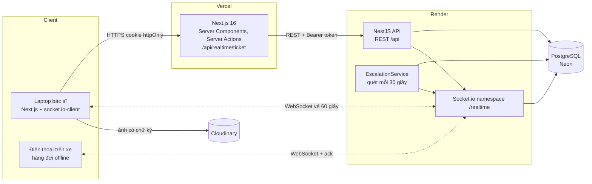
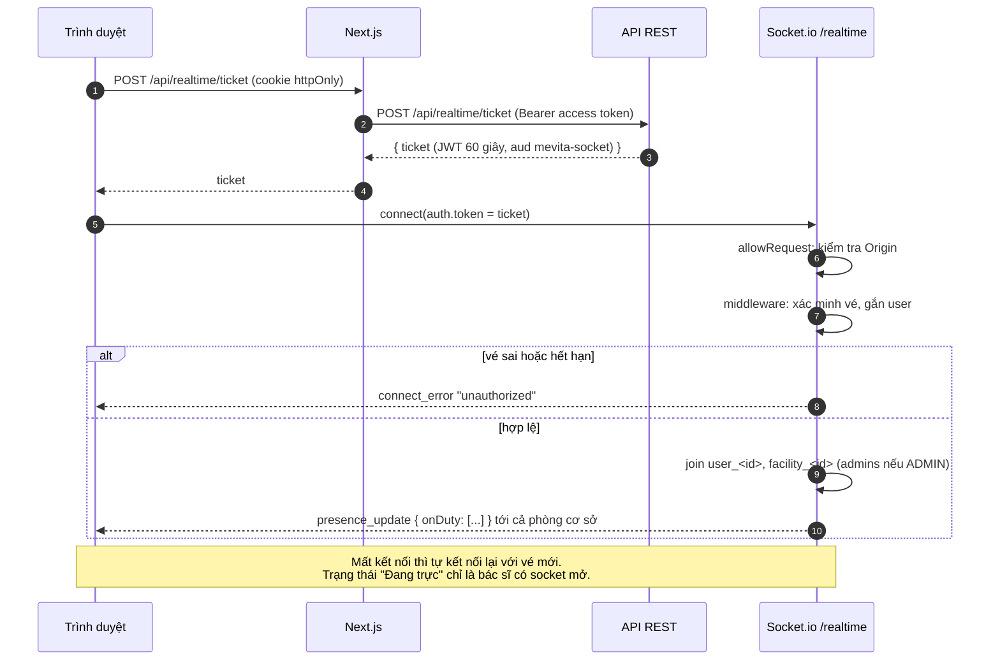
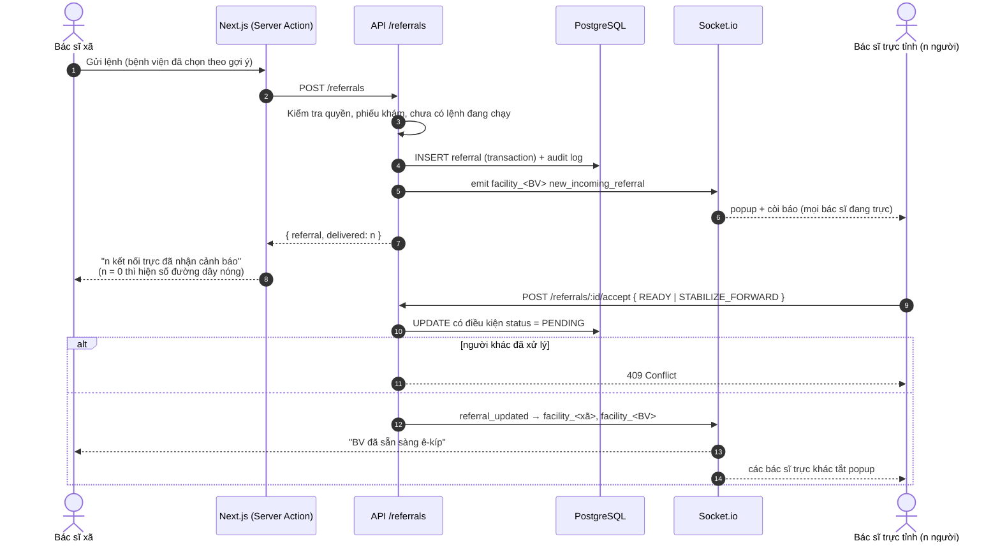
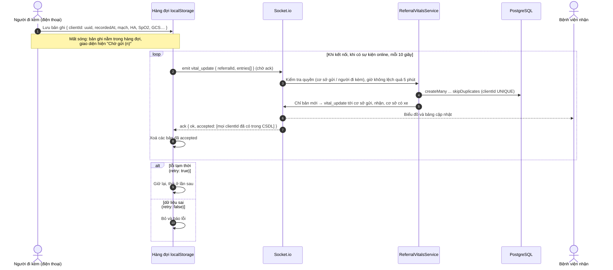
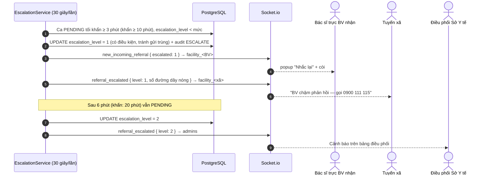
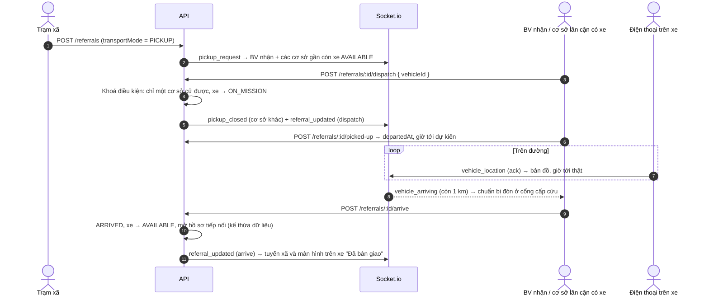

# Chương 3. Thiết kế kênh thời gian thực (Socket.io)

## 3.1. Kiến trúc

| Thành phần            | Quyết định thiết kế                                                                                         | Lý do                                                                                                                                                            |
| --------------------- | ----------------------------------------------------------------------------------------------------------- | ---------------------------------------------------------------------------------------------------------------------------------------------------------------- |
| Xác thực              | **Vé socket** JWT riêng, hạn 60 giây, audience `mevita-socket`. Web cấp vé qua route `/api/realtime/ticket` | Token đăng nhập nằm trong cookie `httpOnly` nên JavaScript không đọc được. Vé ngắn hạn không dùng được để gọi REST                                               |
| Phòng                 | `facility_<id>`, `user_<id>`, `admins`                                                                      | Ca chuyển tuyến gửi tới phòng của bệnh viện, nên mọi bác sĩ đang trực ở đó cùng nhận. Không có sự kiện "tự vào phòng", nên client không nghe lén được cơ sở khác |
| Chiều client → server | Chỉ dùng cho `vital_update` và `vehicle_location`, đều có **ack**                                           | Đây là hai luồng tần suất cao từ thiết bị di động. Ack cho thiết bị biết bản ghi nào đã lưu thì xoá khỏi hàng đợi                                                |
| Chiều server → client | Mọi thay đổi trạng thái đều đi qua REST rồi server phát sự kiện                                             | REST có kiểm tra quyền, transaction, nhật ký. Socket chỉ để thông báo                                                                                            |
| Bảo vệ                | Kiểm tra Origin (`allowRequest`), giới hạn kích thước gói tin 64 KB, khoá tài khoản thì ngắt socket         | Chống kết nối từ trang lạ, chống gói tin quá lớn                                                                                                                 |

## 3.2. Danh mục sự kiện

| Sự kiện                            | Chiều              | Phòng nhận                             | Khi nào                                                         |
| ---------------------------------- | ------------------ | -------------------------------------- | --------------------------------------------------------------- |
| `presence_update`                  | S → C              | `facility_<id>`                        | Có bác sĩ vào hoặc ra ca trực                                   |
| `channel_test`                     | S → C              | `facility_<id>`                        | Kiểm tra kênh trực                                              |
| `new_incoming_referral`            | S → C              | Bệnh viện nhận                         | Có lệnh mới, hoặc nhắc lại khi leo thang (`escalated: 1`)       |
| `referral_updated`                 | S → C              | Cơ sở gửi + cơ sở nhận                 | Tiếp nhận, chuẩn bị, đề nghị chuyển, huỷ, cử xe, đã đón, đã tới |
| `vital_update`                     | C → S (ack), S → C | Cơ sở gửi, cơ sở nhận, cơ sở có xe     | Người đi kèm nhập sinh tồn                                      |
| `vehicle_location`                 | C → S (ack), S → C | Cơ sở gửi, cơ sở nhận, cơ sở có xe     | GPS điện thoại gửi vị trí theo lô                               |
| `vehicle_arriving`                 | S → C              | Cơ sở nhận + cơ sở gửi                 | Xe vào bán kính 1 km                                            |
| `pickup_request` / `pickup_closed` | S → C              | Bệnh viện nhận và cơ sở lân cận còn xe | Trạm yêu cầu xe đón / đã có nơi nhận                            |
| `referral_escalated`               | S → C              | Cơ sở gửi (mức 1), `admins` (mức 2)    | Bệnh viện chậm phản hồi ca cấp cứu                              |
| `capacity_update`                  | S → C              | `admins`                               | Bệnh viện cập nhật số giường                                    |

## 3.3. Kết nối và xác thực

## 3.4. Luồng chuyển tuyến cấp cứu

Không có nút "Từ chối" cho ca tối khẩn/khẩn: API trả `409` nếu cố gọi. Xem [coordination.md](../coordination.md).

## 3.5. Sinh tồn trên xe: offline-first với ack

Gửi lại cùng một lô sẽ không tạo bản trùng và không phát lại sự kiện, nhờ ràng buộc `UNIQUE (client_id)`.
Vị trí xe (`vehicle_location`) dùng đúng giao ước này. Ngoài ra, server tính lại giờ tới từ vị trí thật và phát
`vehicle_arriving` khi xe còn cách đích 1 km.

## 3.6. Leo thang khi bệnh viện chậm phản hồi

## 3.7. Xe đón và tiếp nhận

## 3.8. Kết quả kiểm thử tải

Môi trường: 1 container 4 vCPU, 1 tiến trình Node, công cụ tạo tải chạy cùng máy. Số liệu đầy đủ ở [testing.md](../testing.md).

| Chỉ số                                                 | Kết quả                                                              |
| ------------------------------------------------------ | -------------------------------------------------------------------- |
| Cảnh báo ca mới, 1.000 lệnh đồng thời                  | p50 281 ms, p95 381 ms, **p99 716 ms** (mục tiêu < 1 giây)           |
| Sinh tồn, 250 xe gửi mỗi 2 giây (2.500 lượt giao/giây) | **p99 < 30 ms**                                                      |
| Sinh tồn, 1.000 xe đồng thời                           | CPU 91%, p95 ~0,9 giây, **không mất bản nào**                        |
| Tính đúng                                              | 0 kết nối lỗi, 0 bản mất, 0 bản trùng, 0 lần lọt sang bệnh viện khác |
