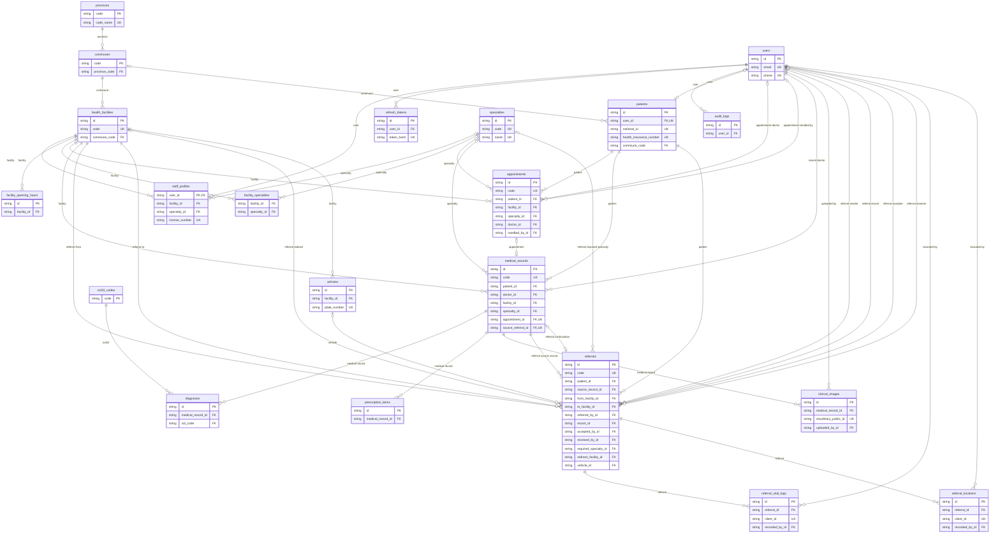

# Sơ đồ thực thể – liên kết (ERD)

> Tệp sinh tự động từ `apps/api/prisma/schema.prisma` bằng `pnpm --filter @mevita/api erd` — không sửa tay.
> Ký hiệu: PK khoá chính, FK khoá ngoại, UK duy nhất. `||--o{` một–nhiều, `||--o|` một–một, `|o` phía cha có thể rỗng.

21 bảng, 44 quan hệ, 20 kiểu liệt kê.

| Bảng | Model | Số cột | Mô tả |
| --- | --- | --- | --- |
| `provinces` | Province | 9 | Đơn vị hành chính cấp Tỉnh (34 đơn vị) |
| `communes` | Commune | 10 | Đơn vị hành chính cấp Xã: Xã / Phường / Đặc khu (3.321 đơn vị) |
| `users` | User | 10 | Tài khoản đăng nhập |
| `staff_profiles` | StaffProfile | 8 | Thông tin công tác của nhân viên y tế — xác định cơ sở mà nhân viên được phép truy cập dữ liệu |
| `refresh_tokens` | RefreshToken | 9 | Refresh token (JWT) — lưu dạng băm để có thể thu hồi |
| `audit_logs` | AuditLog | 8 | Nhật ký truy cập / thao tác trên dữ liệu nhạy cảm (phục vụ kiểm tra bảo mật) |
| `health_facilities` | HealthFacility | 21 | Cơ sở y tế: Trạm y tế xã, Bệnh viện tỉnh, Bệnh viện Trung ương / liên tỉnh |
| `facility_opening_hours` | FacilityOpeningHours | 5 | Giờ làm việc của cơ sở theo ngày trong tuần (mỗi ngày có thể có nhiều ca: sáng, chiều) |
| `specialties` | Specialty | 6 | Danh mục chuyên khoa |
| `facility_specialties` | FacilitySpecialty | 3 | Chuyên khoa mà cơ sở y tế cung cấp |
| `patients` | Patient | 18 | Hồ sơ định danh bệnh nhân. Có thể tồn tại không kèm tài khoản |
| `appointments` | Appointment | 19 | Lịch hẹn khám của bệnh nhân |
| `medical_records` | MedicalRecord | 29 | Hồ sơ một lần khám bệnh (phiếu khám / bệnh án) |
| `icd10_codes` | Icd10Code | 6 | Danh mục mã bệnh quốc tế ICD-10 (nạp ở Task 3.2) |
| `diagnoses` | Diagnosis | 5 | Chẩn đoán của một lần khám: 1 bệnh chính + các bệnh kèm theo |
| `prescription_items` | PrescriptionItem | 10 | Một dòng thuốc trong đơn thuốc |
| `clinical_images` | ClinicalImage | 13 | Ảnh cận lâm sàng lưu trên Cloudinary |
| `referrals` | Referral | 40 | Phiếu chuyển tuyến |
| `referral_vital_logs` | ReferralVitalLog | 15 | Nhật ký chỉ số sinh tồn cập nhật liên tục trên xe chuyển viện |
| `vehicles` | Vehicle | 14 | Xe chuyển viện của cơ sở y tế |
| `referral_locations` | ReferralLocation | 11 | Điểm vị trí của xe trong một ca chuyển tuyến (gửi từ điện thoại người đi kèm) |

## Sơ đồ rút gọn (chỉ cột khoá)

## Sơ đồ đầy đủ

```mermaid
erDiagram
    provinces {
        string code PK "Mã đơn vị hành chính chính thức (QĐ 19/2025/QĐ-TTg), 2 chữ s"
        string name
        string name_en
        string full_name
        string full_name_en
        string code_name UK "Tên không dấu, phân tách bằng '_' (vd: 'lao_cai') — dùng cho"
        enum_ProvinceType type
        datetime created_at
        datetime updated_at
    }
    communes {
        string code PK "Mã đơn vị hành chính chính thức (QĐ 19/2025/QĐ-TTg), 5 chữ s"
        string name
        string name_en
        string full_name
        string full_name_en
        string code_name "Tên không dấu, phân tách bằng '_' (vd: 'muong_khuong') — khô"
        enum_CommuneType type
        string province_code FK
        datetime created_at
        datetime updated_at
    }
    users {
        string id PK
        string email UK "Tên đăng nhập: email hoặc số điện thoại (ít nhất một trong h"
        string phone UK
        string password_hash
        string full_name
        enum_UserRole role
        boolean is_active
        datetime last_login_at
        datetime created_at
        datetime updated_at
    }
    staff_profiles {
        string user_id PK, FK
        string facility_id FK
        enum_StaffPosition position
        string specialty_id FK
        string license_number UK "Số chứng chỉ hành nghề / giấy phép hành nghề"
        string academic_title "Học hàm, học vị hiển thị (vd: 'BSCKI', 'ThS.BS')"
        datetime created_at
        datetime updated_at
    }
    refresh_tokens {
        string id PK
        string user_id FK
        string token_hash UK
        datetime expires_at
        datetime revoked_at
        datetime rotated_at "Thời điểm token bị thay bằng token mới (xoay vòng). Khác nul"
        string user_agent
        string ip_address
        datetime created_at
    }
    audit_logs {
        string id PK
        string user_id FK
        string action "Hành động: VIEW, CREATE, UPDATE, DELETE, LOGIN..."
        string entity_type "Loại đối tượng: MedicalRecord, Patient, Referral..."
        string entity_id
        json metadata
        string ip_address
        datetime created_at
    }
    health_facilities {
        string id PK
        string code UK "Mã cơ sở khám chữa bệnh (mã BHYT)"
        string name
        enum_FacilityType type
        enum_FacilityLevel level
        string commune_code FK "Địa chỉ hành chính — tỉnh được suy ra từ xã"
        string address_detail
        string phone
        string emergency_phone "Đường dây nóng cấp cứu / tiếp nhận chuyển tuyến"
        float latitude
        float longitude
        boolean accepts_referrals "Có tiếp nhận chuyển tuyến cấp cứu hay không"
        int er_beds_total "Năng lực tiếp nhận (Task B) — bệnh viện tự cập nhật; mức tải"
        int er_beds_available
        int icu_beds_available
        string capacity_note
        datetime capacity_updated_at
        int slot_duration_minutes "Thời lượng mỗi khung giờ khám (phút) dùng cho đặt lịch"
        boolean is_active
        datetime created_at
        datetime updated_at
    }
    facility_opening_hours {
        string id PK
        string facility_id FK
        int day_of_week "0 = Chủ nhật, 1 = Thứ Hai … 6 = Thứ Bảy"
        int start_minute "Phút tính từ 00:00 giờ Việt Nam, VD 450 = 07:30"
        int end_minute
    }
    specialties {
        string id PK
        string code UK
        string name UK
        string description
        datetime created_at
        datetime updated_at
    }
    facility_specialties {
        string facility_id FK
        string specialty_id FK
        boolean is_bookable "Có nhận đặt lịch khám trực tuyến cho chuyên khoa này không"
    }
    patients {
        string id PK
        string user_id FK, UK "Tài khoản đăng nhập (nếu bệnh nhân tự đăng ký)"
        string full_name
        datetime date_of_birth
        enum_Gender gender
        string national_id UK "Số Căn cước công dân (12 chữ số)"
        string health_insurance_number UK "Mã thẻ Bảo hiểm y tế"
        datetime health_insurance_expiry
        string phone
        string commune_code FK
        string address_detail
        enum_BloodType blood_type
        string allergies "Tiền sử dị ứng (thuốc, thức ăn...)"
        string chronic_conditions "Bệnh mạn tính / tiền sử bệnh"
        string emergency_contact_name
        string emergency_contact_phone
        datetime created_at
        datetime updated_at
    }
    appointments {
        string id PK
        string code UK "Mã đặt lịch ngắn gọn để tra cứu tại quầy tiếp đón (vd: 'LH8K"
        string patient_id FK
        string facility_id FK
        string specialty_id FK
        string doctor_id FK "Bác sĩ được chọn (không bắt buộc)"
        datetime start_at
        datetime end_at
        string reason "Lý do khám"
        string initial_symptoms "Triệu chứng ban đầu do bệnh nhân khai"
        enum_AppointmentStatus status
        string cancellation_reason
        datetime confirmed_at
        datetime checked_in_at
        datetime cancelled_at
        boolean cancelled_by_patient "Ai huỷ: bệnh nhân hay cơ sở y tế"
        string handled_by_id FK "Nhân viên tiếp đón đã duyệt / huỷ / check-in"
        datetime created_at
        datetime updated_at
    }
    medical_records {
        string id PK
        string code UK
        string patient_id FK
        string doctor_id FK "Bác sĩ trực tiếp khám (tài khoản đang đăng nhập khi tạo)"
        string facility_id FK
        string specialty_id FK "Chuyên khoa của lần khám (lưu tại thời điểm khám, không đổi "
        string appointment_id FK, UK "Lịch hẹn được chuyển thành phiếu khám này (nếu có)"
        string source_referral_id FK, UK "Phiếu chuyển tuyến mà hồ sơ này tiếp nối điều trị (tuyến trê"
        enum_EncounterType encounter_type
        datetime visit_at
        string chief_complaint "Lý do đến khám"
        string symptoms "Triệu chứng / bệnh sử"
        string physical_examination "Khám lâm sàng"
        int pulse
        float temperature
        int systolic_bp
        int diastolic_bp
        int respiratory_rate
        int spo2
        float weight_kg
        float height_cm
        string diagnosis_note "Kết luận / chẩn đoán chi tiết (diễn giải)"
        string treatment_plan "Hướng điều trị / lời dặn"
        datetime follow_up_date
        enum_MedicalRecordStatus status
        datetime signed_at "Thời điểm bác sĩ ký xác nhận hoàn tất khám"
        string signature_hash "Băm SHA-256 nội dung hồ sơ tại thời điểm ký (phát hiện chỉnh"
        datetime created_at
        datetime updated_at
    }
    icd10_codes {
        string code PK "Mã ICD-10, vd: 'S06.5'"
        string name_vi
        string name_en
        string chapter "Chương ICD-10 (I–XXII)"
        string search_text "Mã + tên không dấu, chữ thường — phục vụ tìm kiếm nhanh khôn"
        boolean is_active
    }
    diagnoses {
        string id PK
        string medical_record_id FK
        string icd_code FK
        boolean is_primary "true = bệnh chính, false = bệnh kèm theo"
        string note
    }
    prescription_items {
        string id PK
        string medical_record_id FK
        string drug_name "Tên thuốc (biệt dược)"
        string active_ingredient "Hoạt chất"
        string strength "Hàm lượng, vd: '500mg'"
        float quantity
        string unit "Đơn vị: viên, ống, gói..."
        string instructions "Cách dùng, vd: 'Uống 1 viên x 2 lần/ngày sau ăn'"
        int duration_days
        int sort_order
    }
    clinical_images {
        string id PK
        string medical_record_id FK
        enum_ClinicalImageType type
        string cloudinary_public_id UK
        string secure_url
        string format
        int width
        int height
        int bytes
        string description
        datetime taken_at
        string uploaded_by_id FK
        datetime created_at
    }
    referrals {
        string id PK
        string code UK
        string patient_id FK
        string source_record_id FK "Hồ sơ khám tại tuyến dưới làm căn cứ chuyển tuyến"
        string from_facility_id FK
        string to_facility_id FK
        string referred_by_id FK "Bác sĩ tuyến dưới lập phiếu"
        enum_ReferralPriority priority
        enum_ReferralStatus status
        string reason "Lý do chuyển tuyến"
        string clinical_summary "Tóm tắt bệnh án"
        string initial_treatment "Xử trí sơ cứu ban đầu tại tuyến dưới"
        string escort_id FK "Nhân viên y tế đi kèm trên xe (người cập nhật diễn biến)"
        string vehicle_info "Phương tiện, vd: 'Xe cứu thương 24A-123.45'"
        datetime departed_at
        datetime estimated_arrival_at
        string accepted_by_id FK "Phản hồi của tuyến trên"
        datetime accepted_at
        string preparation_note "Ghi chú chuẩn bị, vd: 'Đã chuẩn bị phòng mổ số 2, dự trù 2 đ"
        string rejection_reason
        string received_by_id FK "Tiếp nhận thực tế khi xe tới"
        datetime arrived_at
        datetime cancelled_at
        string cancellation_reason
        datetime created_at
        datetime updated_at
        string required_specialty_id FK "Chuyên khoa cần ở tuyến trên (bác sĩ tuyến dưới chọn khi lập"
        enum_ReferralAcceptance acceptance_type "Cách tiếp nhận: sẵn sàng ê-kíp, hoặc ổn định rồi chuyển tiếp"
        string forward_note "Kế hoạch chuyển tiếp khi tiếp nhận để ổn định"
        enum_RedirectCategory redirect_category "Ca thường được đề nghị chuyển: lý do chuyên môn & cơ sở đề x"
        string redirect_facility_id FK
        int escalation_level "Leo thang khi bệnh viện chậm phản hồi: 0 chưa, 1 đã nhắc kíp"
        datetime escalated_at
        enum_TransportMode transport_mode "Vận chuyển (Task C): phương thức, xe được giao, các mốc điều"
        string vehicle_id FK
        string transport_note "Lý do khi chọn phương tiện thấp hơn khuyến nghị; thông tin x"
        datetime pickup_requested_at
        datetime pickup_assigned_at
        datetime picked_up_at "Xe đón đã tới trạm và nhận bệnh nhân (bắt đầu chặng chở bệnh"
        datetime arriving_notified_at "Đã báo 'xe sắp tới' cho bệnh viện nhận (vào bán kính cảnh bá"
    }
    referral_vital_logs {
        string id PK
        string referral_id FK
        string client_id UK "UUID do thiết bị sinh ra — chống ghi trùng khi đồng bộ lại s"
        datetime recorded_at "Thời điểm đo thực tế trên xe (giờ của thiết bị)"
        datetime received_at "Thời điểm máy chủ nhận được (chênh lệch lớn = dữ liệu đồng b"
        string recorded_by_id FK
        int pulse
        int systolic_bp
        int diastolic_bp
        int spo2
        int respiratory_rate
        float temperature
        enum_ConsciousnessLevel consciousness
        int gcs "Điểm Glasgow (3–15)"
        string note
    }
    vehicles {
        string id PK
        string facility_id FK
        string plate_number UK
        enum_VehicleType type
        string equipment "Trang bị, VD 'Máy thở, monitor, oxy'"
        string driver_name
        string driver_phone
        enum_VehicleStatus status
        boolean is_active
        float last_latitude "Vị trí gần nhất nhận được (khi đang làm nhiệm vụ)"
        float last_longitude
        datetime last_seen_at
        datetime created_at
        datetime updated_at
    }
    referral_locations {
        string id PK
        string referral_id FK
        string client_id UK "UUID do thiết bị sinh — gửi lại sau lúc mất sóng không ghi t"
        datetime recorded_at
        datetime received_at
        float latitude
        float longitude
        float accuracy "Sai số (mét)"
        float speed "Tốc độ (m/s)"
        float heading
        string recorded_by_id FK
    }
    provinces ||--o{ communes : "province"
    users ||--o| staff_profiles : "user"
    health_facilities ||--o{ staff_profiles : "facility"
    specialties |o--o{ staff_profiles : "specialty"
    users ||--o{ refresh_tokens : "user"
    users |o--o{ audit_logs : "user"
    communes ||--o{ health_facilities : "commune"
    health_facilities ||--o{ facility_opening_hours : "facility"
    health_facilities ||--o{ facility_specialties : "facility"
    specialties ||--o{ facility_specialties : "specialty"
    users |o--o| patients : "user"
    communes |o--o{ patients : "commune"
    patients ||--o{ appointments : "patient"
    health_facilities ||--o{ appointments : "facility"
    specialties |o--o{ appointments : "specialty"
    users |o--o{ appointments : "appointment doctor"
    users |o--o{ appointments : "appointment handled by"
    patients ||--o{ medical_records : "patient"
    users ||--o{ medical_records : "record doctor"
    health_facilities ||--o{ medical_records : "facility"
    specialties |o--o{ medical_records : "specialty"
    appointments |o--o| medical_records : "appointment"
    referrals |o--o| medical_records : "referral continuation"
    medical_records ||--o{ diagnoses : "medical record"
    icd10_codes ||--o{ diagnoses : "icd10"
    medical_records ||--o{ prescription_items : "medical record"
    medical_records ||--o{ clinical_images : "medical record"
    users ||--o{ clinical_images : "uploaded by"
    patients ||--o{ referrals : "patient"
    medical_records ||--o{ referrals : "referral source record"
    health_facilities ||--o{ referrals : "referral from"
    health_facilities ||--o{ referrals : "referral to"
    users ||--o{ referrals : "referral sender"
    users |o--o{ referrals : "referral escort"
    users |o--o{ referrals : "referral acceptor"
    users |o--o{ referrals : "referral receiver"
    specialties |o--o{ referrals : "referral required specialty"
    health_facilities |o--o{ referrals : "referral redirect"
    vehicles |o--o{ referrals : "vehicle"
    referrals ||--o{ referral_vital_logs : "referral"
    users ||--o{ referral_vital_logs : "recorded by"
    health_facilities ||--o{ vehicles : "facility"
    referrals ||--o{ referral_locations : "referral"
    users ||--o{ referral_locations : "recorded by"
```

